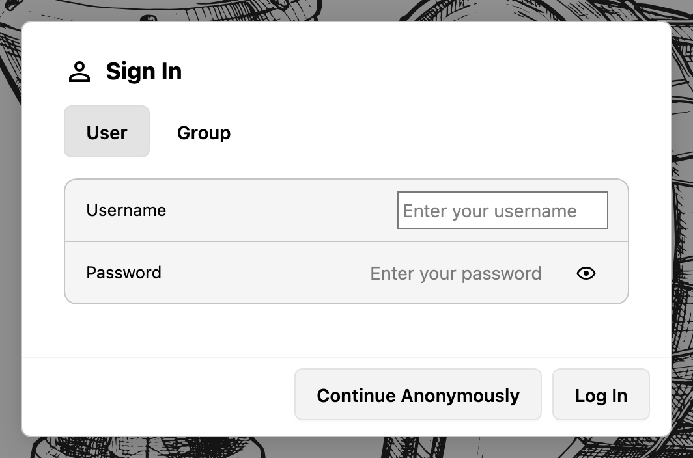

# Deine erste Sitzung

Dieses Kapitel führt dich vom `Sign In`-Dialog bis zu einem Score, der abgespielt und gespeichert wird.

## Die Anwendung erreichen

Öffne die Adresse, die dir dein Administrator genannt hat, zum Beispiel `https://scores.example.org/`. Das Backend liefert die Anwendung, die Musikfonts und die Klangsamples unter derselben Adresse aus, es muss also nichts weiter installiert werden.

Während der Entwicklung läuft das Frontend separat unter `https://localhost:5173`; [Entwicklungs-Setup](../development/setup.md) beschreibt dieses Setup.

Bei einer frischen Installation fragt die Anwendung zuerst die Datenbankverbindung und danach das erste Administratorkonto ab, bevor der `Sign In`-Dialog erscheint. [Animada Score Book installieren](../administration/installation.md) führt durch beide Schritte.

Ist das Backend nicht erreichbar, zeigt die Anwendung anstelle des Score einen Verbindungsdialog mit einem Zähler für die Verbindungsversuche. [Fehlerbehebung und bekannte Einschränkungen](../troubleshooting.md) erklärt, was zu prüfen ist.

## Anmelden

Der `Sign In`-Dialog hat zwei Tabs und bis zu zwei Aktionen:

- **User** erwartet einen `Username` und ein `Password` für ein persönliches Konto.
- **Group** erwartet eine Gruppe aus einer Auswahlliste und das Passwort dieser Gruppe. Nutze diesen Weg, wenn sich mehrere Personen ein Login teilen.
- **`Log In`** bestätigt beide Formulare.
- **`Continue Anonymously`** wird angeboten, solange kein Benutzer erforderlich ist. Anonyme Besucher können alle öffentlich lesbaren Scores durchsuchen und abspielen.

Deine Sitzung bleibt während der Arbeit offen, und das Backend erneuert sie im Hintergrund. Diese Erneuerung nutzt ein sicheres Cookie, weshalb die Installation über HTTPS erreichbar sein muss; siehe [Sicherheitshinweise](../administration/security.md).

Um die Sitzung zu beenden, öffne das Benutzermenü im Header und wähle `Sign Out`.

*Der `Sign In`-Dialog: die Tabs `User` und `Group`, die beiden Felder und `Continue Anonymously` neben `Log In`.*

## Einen Score öffnen

1. Drücke die Schaltfläche `Score Library` im Header. Die Bibliothek öffnet sich als Drawer über dem Score-Bereich.
2. Öffne einen Ordner und wähle einen Score. Das Zeilenmenü bietet `Load Score`, `Copy Score URL`, `Remove Score` und
   `Group Access`.
3. Der Header zeigt den Pfad (`Score Library › <title>`) zusammen mit dem Namen des Score und dessen
   Aufführungsstatistik.

Ein geteilter Link öffnet denselben Score direkt. Solche Links sehen so aus: `https://<host>/?score=<id>`, und sowohl der direkte Link als auch die Bibliothek brauchen Lesezugriff auf den Score.

## Den Score abspielen

Den Transport steuert die playback bar:

- Abspielen und Stoppen über die runde Schaltfläche an ihrem linken Ende.
- Tempo in BPM über `-` und `+`. Ein Stern neben dem Wert bedeutet, dass das Wiedergabetempo vom im Score
  gespeicherten Tempo abweicht; wechsle in den edit mode, um die Änderung zu behalten.
- `Loop playback`, `Metronome`, `Count-in` und die Master-Lautstärke. In schmalen Layouts wandern diese in das Menü
  `More playback controls`.

Das Kapitel [Wiedergabe und Üben](../using/playback.md) behandelt den mixer, Play Focus und den Playhead.

## Zwischen grid view und staff view wechseln

Die mode bar beim Score schaltet dessen Darstellung um:

- `Grid` zeigt das Notenraster, Tooltip `Show the score as a note grid (G)`.
- `Staff` zeigt die Notenschrift, Tooltip `Show the score as staff notation (S)`.

Ein Druck auf `G` oder `S` bewirkt dasselbe, solange der Fokus nicht in einem Textfeld liegt. Die gewählte Ansicht wird in deinem Browser gemerkt und beim nächsten Öffnen der Anwendung wiederhergestellt.

## Zoom und Zen mode

Der Footer enthält die Zoom-Schaltflächen und den Umschalter für den Zen mode:

- `Zoom out` und `Zoom in` ändern den track viewer zoom in 10-%-Schritten zwischen 50 % und 150 %. Derselbe Wert steht
  als `Track viewer zoom` in den Settings zur Verfügung, zusammen mit einer Schaltfläche `Reset`.
- `Enter Zen mode` blendet die umliegenden Bedienelemente aus, sodass nur der Score bleibt; dieselbe Schaltfläche liest
  danach `Exit Zen mode`. Das Kapitel [Einen Score lesen](../using/presentation.md) beschreibt, was sich sonst noch
  ändert.

## Deine Arbeit speichern

Ein Badge neben dem Titel des Score sagt dir, wo der Score steht:

| Badge             | Bedeutung                                                                  |
| ----------------- | -------------------------------------------------------------------------- |
| `Unchanged`       | Der Score wurde geladen und seither nicht bearbeitet.                      |
| `Unsaved changes` | Der Score unterscheidet sich von der auf dem Server gespeicherten Version. |
| `Saved`           | Der Score wurde während dieser Sitzung gespeichert.                        |

`Save Score` im Header schreibt den Score ins Backend und ist aktiviert, solange ungespeicherte Änderungen vorliegen. Im edit mode bewirkt `Ctrl+S` oder `Cmd+S` dasselbe. Das Verlassen des edit mode speichert zuerst, wenn eine Sitzung aktiv ist, und hält dich im edit mode, wenn das Speichern scheitert. Ohne angemeldetes Konto meldet `Save Score` `Sign in to save this score.`, und die Änderungen bleiben in der Kopie im Browser.

Hier passieren zwei voneinander unabhängige Dinge:

- **Der Browser hält eine Kopie** des Score, an dem du arbeitest, sodass ein Neuladen deine Arbeit nicht verwirft.
- **Der Server hält den Score** erst nach dem Speichern, und nur wenn du Schreibzugriff darauf hast. Ein Speichern ohne
  Schreibzugriff scheitert, und die Anwendung meldet es.

Wenn du versuchst, die Seite mit ungespeicherten Änderungen zu verlassen, fragt die Anwendung, ob sie zuerst gespeichert werden sollen.

## Wo die Bedienelemente liegen

| Bereich      | Inhalt                                                                                                                           |
| ------------ | -------------------------------------------------------------------------------------------------------------------------------- |
| Header       | `Score Library`, `New Score`, `Edit Mode`, `Print`, `Export`, `Save Score`, Rückgängig und Wiederholen, `Settings`, Benutzermenü |
| playback bar | Abspielen und Stoppen, Tempo, Loop, Metronom, Count-in, Master-Lautstärke                                                        |
| mode bar     | `Grid` und `Staff`                                                                                                               |
| Footer       | Score-Navigator (`Bar 5 of 32`), Zoom, Zen mode, Versionsschaltfläche mit den Release Notes, notification center                 |

## Nächste Schritte

- [Die Score Library](../using/score-library.md) erklärt Ordner, neue Scores, Importe und Freigaben.
- [Einen Score lesen](../using/presentation.md) erklärt die beiden Ansichten, Musikfonts und Themes.
- [Bearbeiten in der staff view](../using/staff-editing.md) beginnt mit der Noteneingabe.
