# Instrument- und Notationsreferenz

Animada Score Book liefert elf Instrumenttypen, jeder mit eigenen note styles, Symbolen und Klängen. Diese Seite erklärt, wie jedes davon notiert wird und wie es klingt.

Jeder Abschnitt folgt derselben Reihenfolge: was das Instrument ist, wie es im System sitzt, welche note styles der track bietet, welche articulations du ergänzen kannst und was die Wiedergabe damit macht. [Bearbeiten in der staff view](using/staff-editing.md) erklärt, wie du diese Zeichen erzeugst.

## Notationsgrundlagen

Diese Regeln gelten für alle Instrumente:

- Jede track-Zeile beginnt mit einem Perkussionsschlüssel.
- Agogô 2-Bell wird auf zwei Systemlinien notiert, Agogô 4-Bell auf vier, und jedes andere Instrument auf einer
  einzigen Linie.
- Notenwerte von der ganzen bis zur Zweiunddreißigstelnote, punktierte Werte und Pausen verhalten sich wie in jeder
  anderen Notation. Sie werden als bekannt vorausgesetzt; das [Glossar](reference/glossary.md) nennt ihre Namen.
- Ein **note style** entscheidet über Klang und Symbol einer Note. In der grid view erscheint ein style als Symbol in
  der Zelle; im System erscheint er als Form des Notenkopfs und, bei manchen Techniken, als Zeichen neben der Note.
- Eine **articulation** ändert, wie eine Note eines gegebenen style angeschlagen wird: `Accent` zeichnet einen Akzent
  unter die Note, `Ghost` setzt die Note in Klammern und `Damped` ergänzt ein Pluszeichen.
- **Dynamics** (`Crescendo`, `Decrescendo`, `Forte`) spannen über mehrere Takte (englisch: bar) und ändern die Wiedergabelautstärke.
- Farbe und Instrumentensymbol eines track kennzeichnen ihn im mixer und im System, sodass mehrere Instrumente
  unterscheidbar bleiben.

Articulations existieren nur dort, wo ein Instrument eine passende Variante desselben Anschlags bietet: Die Werkzeugleiste bietet Akzent, Damped oder Ghost nur an, wenn die styles des Instruments diese Variante einschließen. Wo ein style bereits mit Akzent oder gedämpftem Klang aufgenommen ist, trägt die Note das passende Zeichen von sich aus, und die Werkzeugleiste für articulations zeigt diese Schaltfläche gedrückt, solange eine solche Note ausgewählt ist.

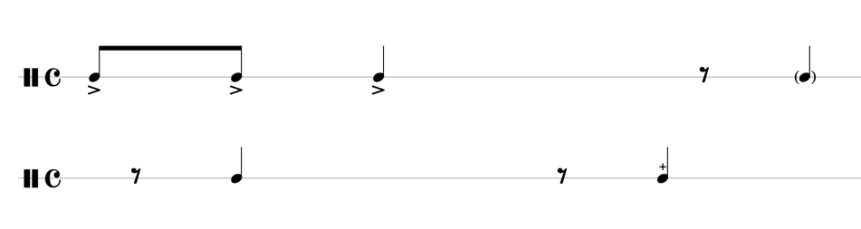

*Akzente unter den Notenköpfen, das Damped-Plus über einem und die Ghost-Note in Klammern.*

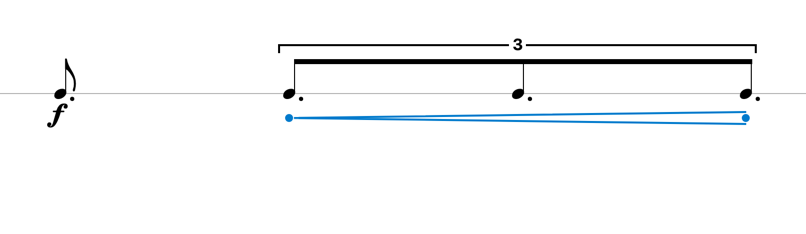

*`Forte` vor der Gruppe und eine `Crescendo`-Gabel darunter; die blauen Punkte sind ihre Ziehgriffe.*

## Die Notenköpfe

Jedes Symbol in der Partitur (englisch: score) entsteht aus einem kleinen Satz von Notenköpfen. Ein Kopf sagt, *wie* der Klang erzeugt wird, nicht *welches* Instrument ihn erzeugt, sodass derselbe Kopf über Instrumente hinweg erscheint: das Quadrat steht für einen Anschlag mit der Hand, etwa auf dem Repinique, dem Timbau oder mit der freien Hand eines Surdo, und das Oval für jeden Anschlag, der nachklingt.

| Kopf                                                                                 | Name             | Bedeutung                                                                           |
| ------------------------------------------------------------------------------------ | ---------------- | ----------------------------------------------------------------------------------- |
| 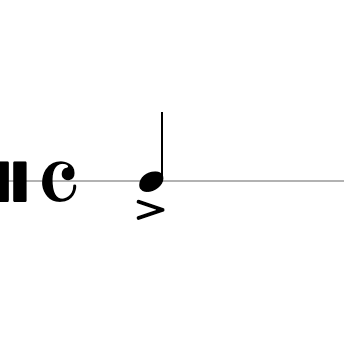                  | `Oval`           | Ein klingender Anschlag: ein Schlag auf ein Fell, eine Glocke oder eine Cuíca       |
|               | `Cross`          | Ein unbestimmter Anschlag jeder Art, etwa ein Schlag auf den Rand                   |
|          | `Square`         | Ein Anschlag mit der Hand, etwa auf einem Repinique, einem Timbau oder einem Surdo  |
| 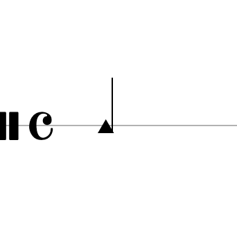         | `Triangle`       | Ein geschütteltes Instrument, etwa ein Chocalho oder eine Ganzá                     |
| 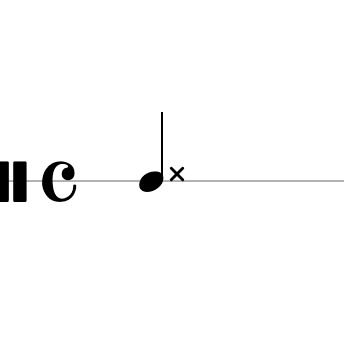 | `Oval` + `Cross` | Stock auf Rand und Fell zugleich: der ovale Kopf mit dem darüber gezeichneten Kreuz |

Daraus folgen einige Regeln:

- Ein Kopf ist nie an ein Instrument gebunden. Welchen Kopf ein style verwendet, gehört zur Instrumentdefinition und ist
  in der Notation der einzelnen Instrumente unten zu sehen.
- Zeichen wie Akzent, Ghost, das Damped-Plus, das Kreuz eines Slap oder die Striche eines Press Roll werden *zusätzlich*
  zum Kopf gezeichnet, sodass ein Symbol aus zwei Grundelementen bestehen kann.
- Das Kreuz allein sagt bereits *unbestimmt*. Ein kurzer Strich unter dem Kopf — wie ihn `Rim` am Repinique nutzt —
  sagt, *wo* der Anschlag landet, der Strich ist also eine Positionsangabe und nicht Teil des Kopfs.
- `Diamond` ist besonderen Klängen wie Glocken vorbehalten; keines der mitgelieferten Instrumente nutzt es derzeit,
  deshalb erscheint es nicht in den Bildern dieser Seite.
- Zwei Stellen, an denen ein Anschlag landen kann, tragen noch kein Zeichen: der Kessel der Trommel und ihre
  Spannschrauben. Kein Instrument dieser Seite nutzt sie.

## Agogô 2-Bell

Die Doppelglocke, mit einem Stick geschlagen. Sie markiert das Muster in vielen Samba-Stilen.

**System:** zwei Linien. Die tiefere Glocke sitzt auf der zweiten Linie, die höhere auf der ersten.

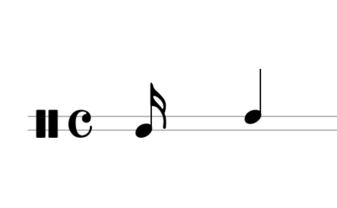

*Die beiden styles der Glocken in Notation: `Low`, dann `High`.*

| note style | Symbol             | Bedeutung                      |
| ---------- | ------------------ | ------------------------------ |
| `Low`      | Oval, untere Linie | Die tiefere der beiden Glocken |
| `High`     | Oval, obere Linie  | Die höhere der beiden Glocken  |

**Articulations:** keine. Die beiden styles sind unterschiedliche Glocken und keine Varianten eines Anschlags, es gibt also nichts zu akzentuieren oder zu dämpfen.

**Wiedergabe:** jeder style spielt seine eigene aufgenommene Glocke.

## Agogô 4-Bell

Das Agogô mit vier Glocken, verwendet, wo ein Muster mehr Tonhöhen braucht.

**System:** vier Linien, eine pro Glocke, von der tiefsten zur höchsten.

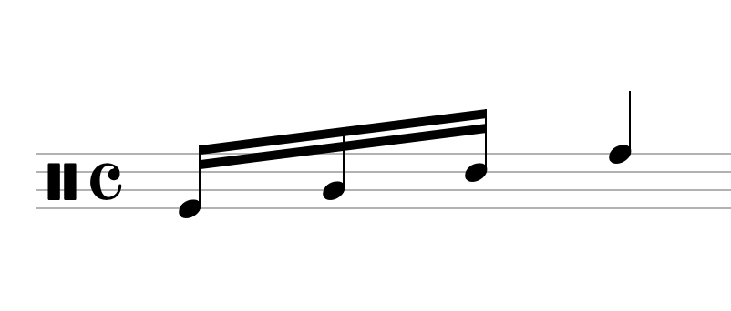

*Eine Note pro Glocke, unterste bis oberste Linie: `Lowest`, `Lower`, `Higher`, `Highest`.*

| note style | Symbol               | Bedeutung                      |
| ---------- | -------------------- | ------------------------------ |
| `Lowest`   | Oval, unterste Linie | Tiefste Glocke, unterste Linie |
| `Lower`    | Oval, dritte Linie   | Zweittiefste, dritte Linie     |
| `Higher`   | Oval, zweite Linie   | Zweithöchste, zweite Linie     |
| `Highest`  | Oval, oberste Linie  | Höchste Glocke, oberste Linie  |

**Articulations:** keine, aus demselben Grund wie beim Agogô mit zwei Glocken.

**Wiedergabe:** jeder style spielt seine eigene Glocke.

## Chocalho

Der Shaker, mit einer Schüttelbewegung gespielt statt mit einem Anschlag.

**System:** eine Linie. Der Notenkopf ist ein Dreieck.

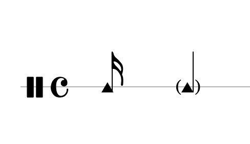

*`Chocalho`, dann die Ghost-Variante.*

| note style | Symbol              | Bedeutung              |
| ---------- | ------------------- | ---------------------- |
| `Chocalho` | Dreieck             | Regelmäßiges Schütteln |
| `Ghost`    | Dreieck in Klammern | Leichtes Schütteln     |

**Articulations:** `Ghost`. Die leichte Variante ist die einzige articulation, die das Instrument bietet.

**Wiedergabe:** Die Anregung ist ein Schütteln, die beiden styles unterscheiden sich daher im Pegel und nicht in der Anschlagstechnik.

## Tamborim

Die kleine Rahmentrommel, mit einem Stick gespielt.

**System:** eine Linie. Der Notenkopf ist ein Kreuz.

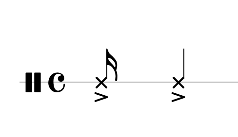

*`Accent`, dann die Ghost-Variante.*

| note style | Symbol             | Bedeutung                                 |
| ---------- | ------------------ | ----------------------------------------- |
| `Accent`   | Kreuz, akzentuiert | Akzentuierter Anschlag                    |
| `Ghost`    | Kreuz in Klammern  | Leichter Anschlag, in Klammern gezeichnet |

**Articulations:** `Accent` und `Ghost`. Der akzentuierte style klingt bereits akzentuiert.

**Wiedergabe:** beide styles sind Einzelanschläge auf demselben Fell; sie unterscheiden sich nur im Pegel.

## Repinique

Die Leittrommel der bateria, mit einem Stick und mit der Hand gespielt.

**System:** eine Linie. Die Stockanschläge nutzen meist einen ovalen Notenkopf; `Rim` nutzt ein Kreuz, und die beiden Handanschläge nutzen ein Quadrat.

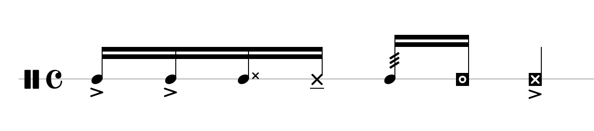

*Alle sieben styles in der Reihenfolge des Taktes: `Center`, `Outer Area`, `Rimshot`, `Rim`, `Buzz`, `Open`, `Slap`.*

| note style   | Symbol                               | Bedeutung                              |
| ------------ | ------------------------------------ | -------------------------------------- |
| `Center`     | Oval, akzentuiert                    | Anschlag auf der Mitte des Fells       |
| `Outer Area` | Oval                                 | Anschlag nahe dem Randbereich          |
| `Rimshot`    | Oval mit einem Kreuz darüber         | Stock zugleich auf Rand und Fell       |
| `Rim`        | Kreuz mit einem Strich darunter      | Stock nur auf dem Rand                 |
| `Buzz`       | Oval, Striche am Hals                | Gedrückter Wirbel mit brummendem Klang |
| `Open`       | Quadrat mit einem Ring               | Offener Handanschlag                   |
| `Slap`       | Quadrat mit einem Kreuz, akzentuiert | Slap mit der Hand                      |

**Articulations:** `Accent`, beim Anschlag auf die Mitte. Die Rand-, Buzz- und Handtechniken haben keine Akzentvariante, die Schaltfläche ist also nicht verfügbar, solange eine davon ausgewählt ist.

**Wiedergabe:** `Center` und `Slap` klingen bereits akzentuiert; die übrigen styles sind einfache Anschläge.

## Repinique (Whippy Sticks)

Dieselbe Trommel, mit flexiblen Whippy Sticks gespielt, was einen leichteren, höheren Klang ergibt.

**System:** eine Linie, ovale Notenköpfe.

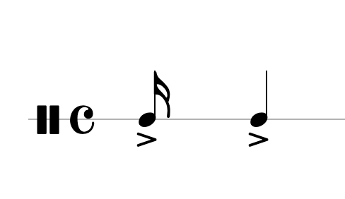

*`Normal`, dann die Ghost-Variante.*

| note style | Symbol            | Bedeutung                                 |
| ---------- | ----------------- | ----------------------------------------- |
| `Normal`   | Oval, akzentuiert | Normaler Anschlag mit Whippy Sticks       |
| `Ghost`    | Oval in Klammern  | Leichter Anschlag, in Klammern gezeichnet |

**Articulations:** `Accent` und `Ghost`.

**Wiedergabe:** der normale Anschlag klingt bereits akzentuiert, leise Passagen brauchen daher den Ghost-style.

## Caixa

Die Snare Drum der bateria, mit zwei Sticks gespielt.

**System:** eine Linie, ovale Notenköpfe.

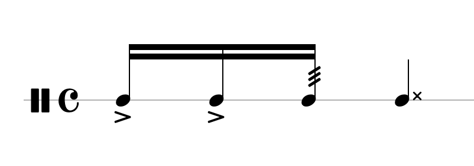

*`Normal`, `Ghost`, `Press Roll`, `Rimshot`.*

| note style   | Symbol                       | Bedeutung                                 |
| ------------ | ---------------------------- | ----------------------------------------- |
| `Normal`     | Oval, akzentuiert            | Normaler Anschlag                         |
| `Ghost`      | Oval in Klammern             | Leichter Anschlag, in Klammern gezeichnet |
| `Press Roll` | Oval, Striche am Hals        | Gedrückter Wirbel                         |
| `Rimshot`    | Oval mit einem Kreuz darüber | Stock zugleich auf Rand und Fell          |

**Articulations:** `Accent` und `Ghost`.

**Wiedergabe:** der normale Anschlag klingt bereits akzentuiert; Ghost-Noten, der Press Roll und der Rimshot haben eigene Klänge.

## Timbau

Die Handtrommel, mit Open-, Slap- und Bass-Anschlag gespielt.

**System:** eine Linie, quadratische Notenköpfe.

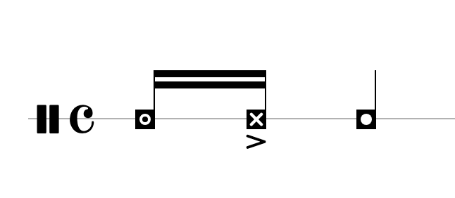

*`Open`, `Slap`, `Bass`.*

| note style | Symbol                               | Bedeutung                        |
| ---------- | ------------------------------------ | -------------------------------- |
| `Open`     | Quadrat mit einem Ring               | Offener Handanschlag             |
| `Slap`     | Quadrat mit einem Kreuz, akzentuiert | Slap mit der Hand                |
| `Bass`     | Quadrat mit einem Punkt              | Bass-Anschlag mit dem Handballen |

**Articulations:** keine. Die drei styles sind unterschiedliche Handtechniken und keine Varianten eines Anschlags.

**Wiedergabe:** der Slap klingt bereits akzentuiert; Open- und Bass-Anschlag sind einfach.

## Surdo Terceira

Der kleinste und höchste der drei Surdos.

**System:** eine Linie. Stockanschläge sind Ovale; ein Anschlag mit der freien Hand — das Fell dämpfend oder eine eigene Note spielend — ist ein Quadrat.

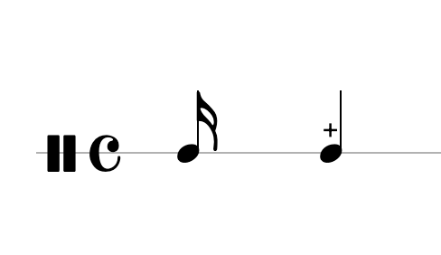

*`Center`, dann `Muted`.*

| note style | Symbol              | Bedeutung                |
| ---------- | ------------------- | ------------------------ |
| `Center`   | Oval                | Offener Anschlag         |
| `Muted`    | Oval mit einem Plus | Gedämpfter Stockanschlag |

**Articulations:** `Damped`, was derselbe Klang wie der muted style ist und für Noten angeboten wird, die den offenen style nutzen.

**Wiedergabe:** der gedämpfte Anschlag ist kürzer und dumpfer; die beiden styles sind ansonsten gleich. Die Dämpfung entsteht durch die auf dem Fell ruhende freie Hand oder — wie in der Roda de Samba — durch das Drücken des Sticks auf das Fell direkt nach dem Schlag.

## Surdo Segunda

Der mittlere Surdo, zwischen terceira und primeira.

**System:** eine Linie. Stockanschläge sind Ovale; ein Anschlag mit der freien Hand — das Fell dämpfend oder eine eigene Note spielend — ist ein Quadrat.

*`Center`, dann `Muted`.*

| note style | Symbol              | Bedeutung                |
| ---------- | ------------------- | ------------------------ |
| `Center`   | Oval                | Offener Anschlag         |
| `Muted`    | Oval mit einem Plus | Gedämpfter Stockanschlag |

**Articulations:** `Damped`, wie beim terceira.

**Wiedergabe:** gleiches Verhalten wie beim terceira, mit dem tieferen Klang.

## Surdo Primeira

Der größte und tiefste Surdo, der den Puls der bateria trägt.

**System:** eine Linie. Stockanschläge sind Ovale; ein Anschlag mit der freien Hand — das Fell dämpfend oder eine eigene Note spielend — ist ein Quadrat.

*`Center`, dann `Muted`.*

| note style | Symbol              | Bedeutung                |
| ---------- | ------------------- | ------------------------ |
| `Center`   | Oval                | Offener Anschlag         |
| `Muted`    | Oval mit einem Plus | Gedämpfter Stockanschlag |

**Articulations:** `Damped`, wie bei den beiden anderen Surdos.

**Wiedergabe:** der tiefste der drei Surdos.

## Verwandte Kapitel

- [Bearbeiten in der staff view](using/staff-editing.md) erklärt note styles, articulations und dynamics in der Praxis.
- [Wiedergabe und Üben](using/playback.md) erklärt den mixer und wie einzelne Noten vorangehört werden.
- [Glossar](reference/glossary.md) definiert die hier verwendeten Musikbegriffe.
