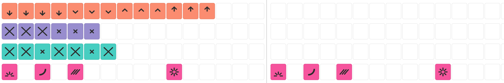
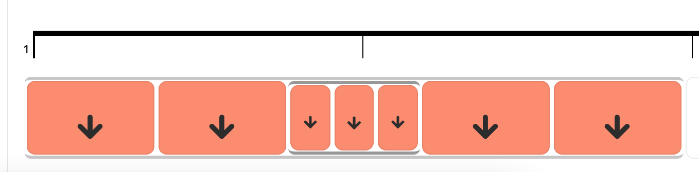
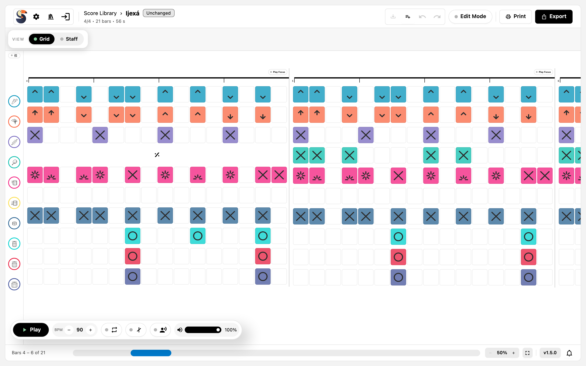

# Bearbeiten in der grid view

Die grid view ist die schnelle Spur für Rhythmus: eine Zelle pro Schritt, ein Symbol pro Zelle. Sie ist die bessere Ansicht, um Muster schnell einzugeben, und die staff view die bessere für Details. Beide bearbeiten denselben Score.

## Das Raster

Die grid view teilt jede bar in feste Schritte:

- Ein in der Anwendung angelegter Score verwendet 16 Schritte pro bar in 4/4, 6 in 6/8, 10 in 5/4 und 7 in 7/8.
- Eine Zelle deckt genau einen Schritt ab und hält höchstens eine Note oder Pause.
- Jede Zelle zeichnet das Symbol ihres note style, eingefärbt mit der Farbe des track.

Weil das Raster fest ist, beginnt eine Note in der grid view immer auf einem Schritt und hat immer eine Länge, die das Raster ausdrücken kann. Die staff view hat keine solche Grenze.

*Zwei bars in der grid view: ein Symbol pro Schritt, pro track eingefärbt. Die kleineren Symbole in den abgerundeten Zellen sind Ghost-Noten und leichte Anschläge.*

## Noten eingeben und entfernen

1. Klicke eine Zelle an, um den Cursor zu setzen, oder bewege den Cursor mit den Pfeiltasten.
2. Drücke `1` bis `9` für den note style an dieser Position der Instrumentenliste, oder nutze die note style-Schaltflächen
   der Werkzeugleiste.
3. Ein gewählter Notenwert gilt für die Note, die du eingibst; sie wird auf den freien Platz vor der nächsten Note
   gekürzt.

Eine Zelle ohne Inhalt zeigt nichts. `0` macht die Zelle am Cursor zu einer Pause, und `Delete` oder `Backspace` entfernt die Note oder Pause dort.

## note styles

Beide Ansichten bieten note styles an derselben Stelle: der note style-Abschnitt der Werkzeugleiste über dem Score, oder die Zifferntasten für den adressierten track. Die grid view fügt kein eigenes Menü hinzu, ein Rechtsklick auf eine Zelle hat also keine Aktion.

## Welche Bedienelemente die grid view bietet

Die grid view behält die Bedienelemente, die ihr Raster erfüllen kann, und blendet den Rest aus:

| Bedienelement                        | In der grid view | Warum                                            |
| ------------------------------------ | ---------------- | ------------------------------------------------ |
| note style und Spieltechnik          | verfügbar        | Jede Zelle hält einen style                      |
| Articulations                        | verfügbar        | Ein Zeichen an der Note in der Zelle             |
| Notenwert / Dauer                    | ausgeblendet     | Das Raster entscheidet über die möglichen Längen |
| `Entry`-Modus (`Overwrite`/`Insert`) | ausgeblendet     | Die grid view überschreibt immer                 |
| Dynamics                             | ausgeblendet     | Nur die staff view setzt dynamics                |

## Auswählen

- Klicke eine Zelle an, um sie auszuwählen.
- Ziehe ein Rechteck auf, um die Zellen auszuwählen, die es bedeckt.
- `Shift`+Klick fügt der Auswahl Zellen hinzu.
- `Escape` hebt die Auswahl auf.

Eine Auswahl ist die Eingabe für die Werkzeugleiste: Die Wahl eines note style wendet ihn auf die ausgewählten Zellen an, und die Wahl einer articulation markiert die ausgewählten Noten.

## Subdivisions in der grid view

Eine subdivision belegt eine Zelle und zeigt ihre Teilschritte darin. Daraus folgen zwei Regeln:

- Innerhalb einer subdivision wird jeder Slot für sich adressiert, und die Länge der Zelle gilt nicht mehr.
- Eine leere subdivision wird mit `Delete` oder `Backspace` entfernt; eine subdivision, die noch Noten hält, muss zuerst
  geleert werden.

*Dasselbe verschachtelte tuplet wie in der staff view: Das Quintuplet füllt die erste Hälfte der bar, sodass seine fünf Slots schmaler sind als die Zellen drumherum, und das Triplet im dritten Slot wird zu drei eigenen Slots.*

[Bearbeiten in der staff view](staff-editing.md) erklärt die Verhältnisse, die Verschachtelung und die drei Arten, eine kopierte subdivision einzufügen.

## Was die grid view nicht kann

Einige Dinge existieren nur in der staff view, weil sie mehr Platz brauchen als eine Zelle:

- Freie Notenwerte, die nicht ins Raster passen.
- bar-Breiten, die durch Ziehen eines Taktstrichs angepasst werden.
- Dynamics wie Crescendo, Decrescendo und Forte.
- Das Setzen einer Wiederholung über eine bar (simile): Das Zeichen gehört zu einem track piece, und die grid view wählt
  keine track pieces aus. Ein in der staff view gesetztes simile erscheint in der grid view als Wiederholungszeichen über
  diesem Takt.

*bar 4 eines track: Das simile steht für bar 3, sodass die grid view das Wiederholungszeichen anstelle der Zellen dieses track zeichnet.*

Wenn eine Änderung eines davon braucht, wechsle in die staff view und wieder zurück; beide Ansichten zeigen denselben Score.

## Die Ansicht während einer Sitzung wechseln

`Grid` und `Staff` in der mode bar oder die Tasten `G` und `S` wechseln jederzeit. Die Wiedergabe läuft weiter, der Score bleibt geladen, und ungespeicherte Änderungen bleiben ungespeichert — nichts geht verloren, wenn du den Score von der anderen Seite betrachtest.

## Verwandte Kapitel

- [Bearbeiten in der staff view](staff-editing.md) behandelt Notenwerte, articulations, subdivisions, dynamics und das
  Clipboard.
- [Einen Score lesen](presentation.md) erklärt, wofür welche Ansicht gut ist.
- [Wiedergabe und Üben](playback.md) erklärt Play Focus, den die grid view ebenfalls nutzt.
