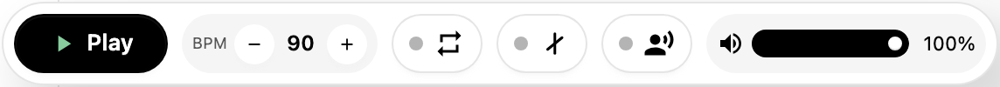
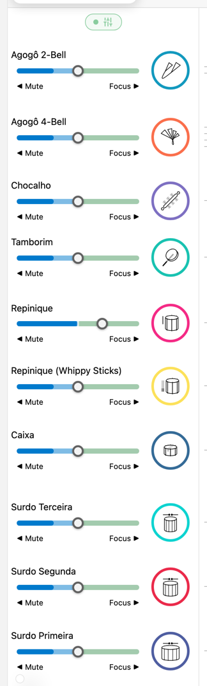
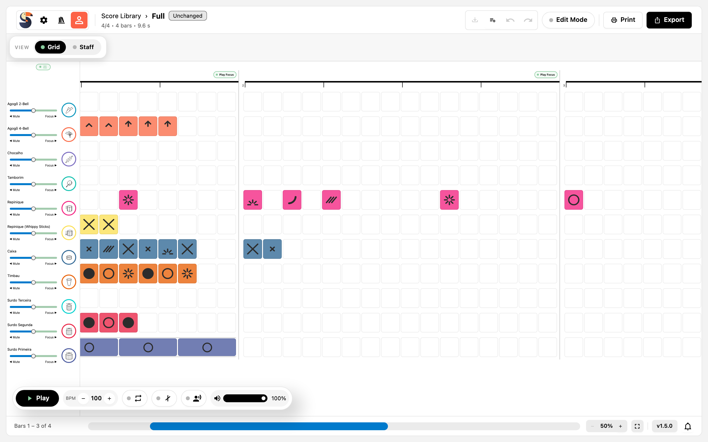

# Wiedergabe und Üben

Die playback bar und der mixer machen aus einem Score eine Probe: Die Instrumente des Score spielen zusammen, ein track kann angehoben werden, während die anderen zurücktreten, und ein Metronom oder Count-in hält die Zeit.

## Starten und Stoppen

Die runde Schaltfläche am linken Ende der playback bar startet und stoppt den Score; ihr Tooltip liest `Play the score` oder `Stop playback`. Stoppen kehrt an den Anfang des gespielten Bereichs zurück, sodass der nächste Start dort beginnt.

*Die playback bar: Play, `BPM`-Schrittregler, Loop, Metronom, Count-in und die Master-Lautstärke; die drei Schalter tragen einen Punkt, der sich füllt, wenn sie an sind.*

## Tempo

Der Tempo-Schrittregler zeigt das aktuelle Tempo in `BPM` und ändert es mit `-` und `+`:

- Der Bereich reicht von 30 bis 200 BPM in Schritten von 5.
- Ein Stern neben dem Wert, zum Beispiel `118*`, bedeutet, dass das Wiedergabetempo vom im Score gespeicherten Tempo
  abweicht.
- Ohne edit mode ist die Änderung vorübergehend. Im edit mode wird das neue Tempo in den Score geschrieben, wenn du
  speicherst.

## Master-Lautstärke

Der Regler mit der Bezeichnung `Master volume` stellt den Gesamtpegel zwischen 0 % und 100 % ein. Er skaliert alles, auch die Notensamples, die du beim Klick auf eine Note hörst.

## Der mixer

Der mixer lebt in der track-Spalte links vom Score. `Expand mixer` und `Collapse mixer` wechseln zwischen den reinen Instrumentnamen und der vollen Lautstärkespalte:

| Position        | Wirkung                                                                                              |
| --------------- | ---------------------------------------------------------------------------------------------------- |
| `0`             | Der track ist stumm — das linke Ende der Spalte ist mit `◀︎ Mute` beschriftet                        |
| `1` bis `100 %` | Der track spielt auf seinem normalen Pegel                                                           |
| über `100 %`    | Der track wird angehoben, und die anderen tracks werden abgesenkt — das rechte Ende liest `Focus ▶︎` |

Der Focus-Boost ist keine Solo-Taste: Die anderen tracks bleiben hörbar, nur leiser. Die Pegel pro track gehören zu deinem Arbeitszustand und werden mit dem Score gespeichert.

*Der ausgeklappte mixer von Ijexá: ein Regler und ein Instrumentensymbol pro track, `◀ Mute` am linken und `Focus ▶` am rechten Ende.*

## Metronom und Count-in

Zwei Schalter stehen neben dem Tempo:

- `Metronome` setzt einen Klick auf jeden Schlag.
- `Play a count-in before playback starts` spielt eine bar Count-in, bevor der Score beginnt. Der Count-in nutzt
  gesprochene Zahlen und ist keines der wählbaren Instrumente.

Beide sind unabhängig vom Inhalt des Score und lassen sich mit dem Loop kombinieren.

## Looping

`Loop playback` wiederholt den gespielten Bereich, bis du stoppst. Ohne Play Focus wiederholt es den ganzen Score; mit einem Play Focus wiederholt es diesen Bereich.

Loop ist eine reine Wiedergabefunktion: Er gehört nicht zu einem MP3-Export.

## Play Focus

Jeder bar-Kopf trägt eine Schaltfläche `Play Focus`. Markierte bars beschränken die Wiedergabe auf sich:

- Ohne fokussierte bar verwendet die Wiedergabe den ganzen Score.
- Mit fokussierten bars beginnt die Wiedergabe an der ersten fokussierten bar und endet an der letzten.
- Die Einstellung ist ein Wiedergabebereich, keine Auswahl: Sie ändert den Score nicht und wird nicht als Inhalt
  gespeichert.

Dasselbe Element gibt es in der grid view und in der staff view.

*bars 2 und 3 fokussiert: ihre Schaltflächen `Play Focus` sind aktiv, die Nachbarn nicht, und die Regler des mixer zeigen die Enden `Mute` und `Focus` pro track.*

## Wiedergabereihenfolge und Wiederholungen

Die Wiedergabe folgt den Wiederholungstaktstrichen des Score, nicht der geschriebenen Reihenfolge von links nach rechts. Ein Paar aus `Repeat start` und `Repeat end` wird zweimal gespielt, und eine Wiederholung über eine bar (simile) spielt die bar, für die sie steht. Die bar-Beschriftung im Footer und der score navigator zeigen, wo du dich dabei befindest.

## Playhead und Scrollen

Während der Score spielt, bewegt sich ein Playhead durch ihn, und die Ansicht folgt, damit die aktuellen bars sichtbar bleiben. Du kannst während der Wiedergabe weiter scrollen; der Playhead bewegt sich im Score weiter.

## Eine einzelne Note hören

Ein Klick auf eine Note spielt ihr Sample, was beim Arrangieren hilft: Das Instrument antwortet, bevor der Transport läuft. Die Master-Lautstärke gilt auch hier.

## Schmale Bildschirme

Auf kleinen Bildschirmen behält die playback bar den Transport und das Tempo und faltet `Loop playback`, `Metronome`, `Count-in` und `Volume` in das Menü `More playback controls`. Ein Punkt auf dieser Schaltfläche zeigt, wenn eine dieser Optionen aktiv ist.

## Verwandte Kapitel

- [Einen Score lesen](presentation.md) erklärt die Ansichten und den Footer.
- [Bearbeiten in der staff view](staff-editing.md) legt die Wiederholungen, simile-Zeichen und dynamics an, die die Wiedergabe
  nutzt.
- [Drucken, PDF und MP3-Export](printing-and-export.md) behandelt den Export der Wiedergabe als Datei.
