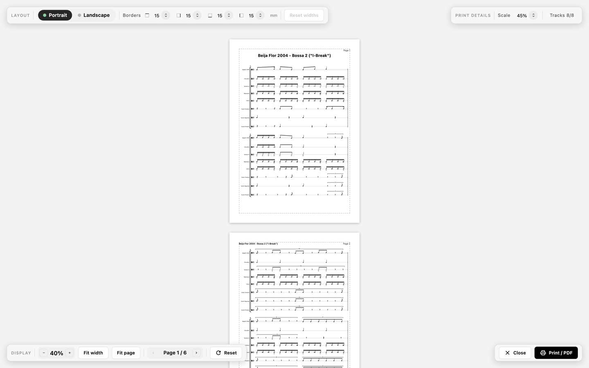
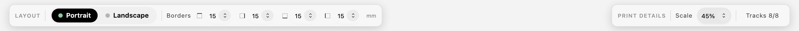
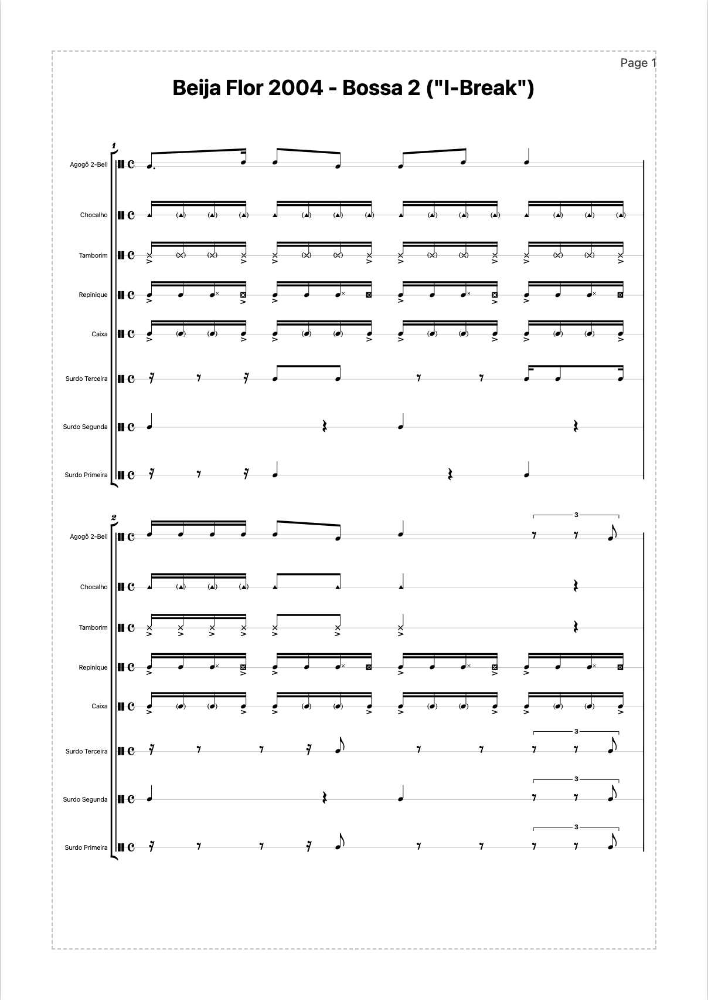
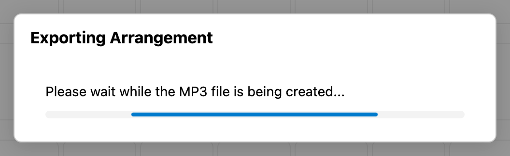

# Drucken, PDF und MP3-Export

Zwei Ergebnisse verlassen die Anwendung: Papier über den Druckdialog des Browsers und eine Audiodatei. Die print preview ist der Ort, an dem das Blatt eingerichtet wird; der MP3-Export übernimmt den aktuellen Wiedergabezustand.

## Die print preview öffnen

`Print` im Header (Tooltip `Print / Export to PDF`) öffnet die Vorschau anstelle des Score. `Ctrl`/`Cmd`+`P` bewirkt dasselbe und ersetzt den Druckdialog des Browsers. `Escape` schließt die Vorschau und kehrt mit unveränderten Einstellungen zum Score zurück.

*Die Vorschau von I-Break: Seiten, wie sie gedruckt werden, mit den Steuerelementen für Layout, Druck und Anzeige darüber.*

## Seiteneinrichtung

Die Steuerelemente der Vorschau richten das Blatt ein:

| Steuerelement   | Werte                                                             |
| --------------- | ----------------------------------------------------------------- |
| Ausrichtung     | `Portrait` oder `Landscape`, beide auf A4-Papier                  |
| Ränder          | Ein Wert pro Seite, von −5 mm bis 50 mm in Schritten von 5        |
| Druckskalierung | 10 % bis 200 %, Standard 45 %                                     |
| tracks          | `Tracks n/m` mit einer track-Auswahlliste und `Select All Tracks` |

Die Druckskalierung entscheidet, wie groß die Notation auf dem Papier erscheint. Negative Randwerte sind Absicht: Sie lassen eine Seite mehr vom Papier nutzen, als der eigene Rand des Druckers erlauben würde, was manche Drucker akzeptieren.

`Reset the print settings` stellt die Standardwerte wieder her, und `Close the preview (ESC)` verlässt die Vorschau.

*`Layout` enthält die Ausrichtung und die vier Randwerte, `Print details` die Skalierung und die track-Auswahl.*

## bar-Breiten in der Vorschau

Die Vorschau zeigt dieselben bar-Breiten wie die staff view. Ziehen an einem Griff am Taktstrich ändert, wie breit diese bar gedruckt wird; der Tooltip liest `Drag to change the printed width. Double-click to restore the score width.` `Reset widths` stellt alle auf einmal wieder her.

## Vorschau-Zoom und Seiten

Die Vorschau zoomt unabhängig von der Druckskalierung:

- Heraus- und Hineinzoomen zwischen 10 % und 400 %.
- `Fit width` und `Fit page` wählen einen Zoom, der das Blatt passend macht.
- `Previous page` und `Next page` blättern durch die Seiten.

Der Vorschau-Zoom betrifft nur, was du am Bildschirm siehst; das gedruckte Ergebnis folgt der Druckskalierung.

## Drucken und als PDF speichern

`Print` in der Werkzeugleiste der Vorschau, Tooltip `Print or save as PDF`, öffnet den Druckdialog des Browsers. Für ein Ergebnis, das zur Vorschau passt:

1. Wähle A4 als Papierformat.
2. Wähle dieselbe Ausrichtung wie in der Vorschau.
3. Setze die Skalierung des Browsers auf 100 %, denn die Druckskalierung dimensioniert die Notation bereits.
4. Deaktiviere Kopf- und Fußzeilen des Browsers; das Dokument bringt eigene Ränder, Titel und Seitenzahlen mit.

Die Wahl des PDF-Druckers in diesem Dialog erzeugt die PDF-Datei. Die Anwendung erzeugt selbst kein PDF, das Ergebnis hängt also von der Druck-Engine des Browsers ab.

*Das erste Blatt bei `Fit page`: Titelkopf, bar-Nummern, Instrumentnamen und die Seitenzahl in der Ecke.*

## Einen MP3 exportieren

`Export` im Header (Tooltip `Export as MP3`) rendert den aktuellen Wiedergabezustand in eine Datei namens `<score title>.mp3`:

- Ein Fortschrittsdialog bleibt offen, solange die Datei gerendert wird.
- Der Export folgt den Wiedergabeeinstellungen, sodass Tempo, Lautstärken pro track und der Count-in in der Datei hörbar
  sind.
- Looping wird ignoriert, und es gibt keine Möglichkeit, nur einen Play Focus-Bereich zu exportieren.
- Auf Telefonen wird die Datei über das Teilen-Menü des Systems angeboten; überall sonst lädt der Browser sie herunter.
- Kann der Browser kein MP3 kodieren oder scheitert das Rendern, meldet die Anwendung
  `The MP3 could not be exported. Please try again.`

*Der Dialog bleibt offen, während der ganze Score gerendert wird; `Export` im Header bleibt bis dahin deaktiviert.*

## Was die Ausgabe nicht kann

- Es gibt keine PDF-Erzeugung innerhalb der Anwendung; PDF kommt aus dem Druckdialog des Browsers.
- Der MP3-Export braucht die MP3-Kodierung des Browsers, weshalb er für Chromium dokumentiert ist.
- Ein Druckergebnis kann von der Vorschau abweichen, wenn der Browser eigene Ränder, Kopfzeilen oder eine andere Skalierung
  hinzufügt.

[Fehlerbehebung und bekannte Einschränkungen](../troubleshooting.md) führt diese als bekannte Einschränkungen auf.

## Verwandte Kapitel

- [Einen Score lesen](presentation.md) erklärt Musikfonts und Zoom.
- [Wiedergabe und Üben](playback.md) erklärt Tempo, mixer und Count-in, die der MP3-Export nutzt.
- [Bearbeiten in der staff view](staff-editing.md) behandelt bar-Breiten im Score selbst.
