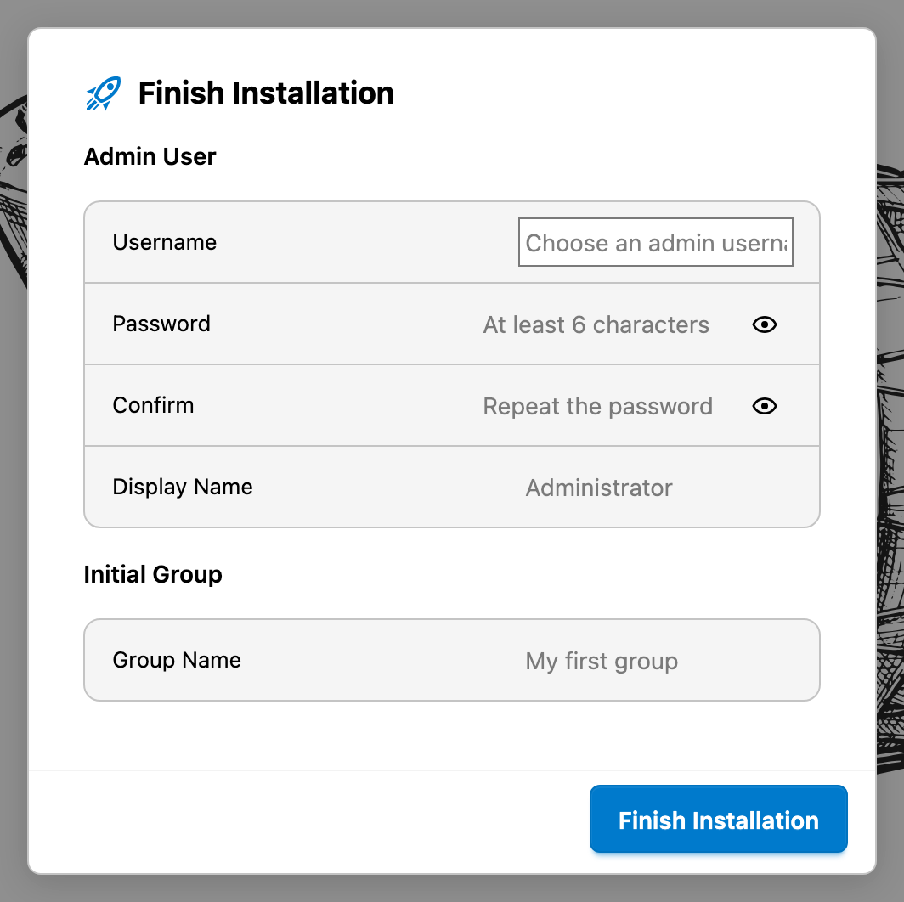
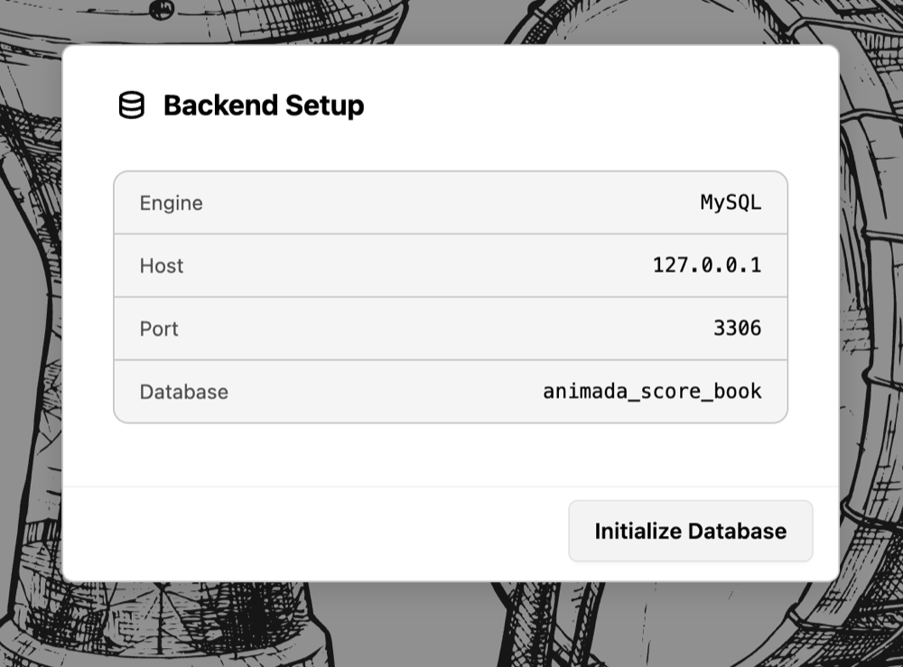

# Installing Animada Score Book

An installation consists of two parts: a Node.js backend with a database, and the browser application that this backend serves. Everything runs on one server; users only need a browser and the address of that server.

## Requirements

| Component        | Requirement                                                                         |
| ---------------- | ----------------------------------------------------------------------------------- |
| Node.js          | 24.15 or 26, as stated in the `engines` field of `package.json`                     |
| Database         | MySQL/MariaDB or PostgreSQL, reachable from the server                              |
| Database account | A user who may create tables, indexes, and foreign keys in the application database |
| Host name        | A name or IP address users can reach                                                |
| Disk space       | The package itself and the uploaded files below `public/uploads`                    |

## HTTPS

The application has to be reachable over HTTPS: the session refresh cookie is marked `Secure`, and without TLS the browser drops it, so a session ends silently after 15 minutes instead of being renewed.

The backend itself serves plain HTTP, and the application configures no TLS of its own. HTTPS comes from whatever the backend sits behind: in development that is the Vite dev server, which serves `https://localhost:5173` with local certificates and forwards `/api` and `/soundLib` to the backend; in production it is the web server of the hosting environment. Nothing in the application has to be configured for that. `"trustProxy"` stays off unless the endpoint in front forwards the original host and protocol as headers and the backend should trust them; [Configuring the Backend](configuration.md) documents the key and [Security Notes](security.md) explains the cookie.

## What the Deployment Package Contains

The package is built from the repository with `npm run package`. It writes `dist-package/animada-score-book-<version>.tar.gz` and contains:

| Path                                                       | Purpose                                                         |
| ---------------------------------------------------------- | --------------------------------------------------------------- |
| `dist/`                                                    | The built browser application                                   |
| `server.js`                                                | The backend, bundled with all of its dependencies into one file |
| `public/`                                                  | Music fonts, sound samples, logos, and uploaded files           |
| `build/seed.sql`                                           | Initial folders and scores, imported into an empty database     |
| `migrations/`                                              | The schema and its migrations                                   |
| `package.json`                                             | A manifest with a single `start` script and no dependencies     |
| `backend-config.example.json`                              | Template for the configuration file                             |
| `docs/en/`, `readme.md`, `release-notes.md`, `License.txt` | Offline documentation and licence                               |

The archive never contains `backend-config.json`, `.env` files, `node_modules`, TypeScript sources, or a lock file.

## Unpacking

```bash
tar -xzf animada-score-book-<version>.tar.gz
cd animada-score-book-<version>
```

There is no installation step: `server.js` carries the backend together with `mysql2`, `pg`, `jsonwebtoken`, and `mime-types`, and `dist/` carries the built browser application. The package needs Node.js, and nothing else.

## Configuring the Backend

The backend reads `backend-config.json` from the directory it is started in. The file is not optional: it carries
the database connection, and the backend never creates the database itself. In a hosting environment the database
and its account are created with the tools of the hoster, which cannot be reached from the application, so these
values are always supplied by hand.

Create the file from the template:

```bash
cp backend-config.example.json backend-config.json
```

Then edit at least the database block. A minimal MySQL configuration looks like this:

```json
{
    "host": "0.0.0.0",
    "port": 3100,
    "database": {
        "engine": "mysql",
        "host": "127.0.0.1",
        "port": 3306,
        "database": "animada",
        "user": "animada",
        "password": "secret"
    }
}
```

For PostgreSQL, set `"engine": "postgres"` and the matching port. Every key and every environment variable that overrides it is described in [Configuring the Backend](configuration.md).

The backend also needs the `JWT_SECRET` environment variable and refuses to start without it. Keep it out of the configuration file and provide it through the service manager, for example:

```bash
JWT_SECRET="<long random value>" node server.js
```

## Preparing the Database

Create an empty database and a user for it. The backend creates the schema itself, either when the dialog in the browser initialises the database or, with `"autoMigrate": true`, on start, so the database only has to exist. The account needs the right to create tables, indexes, and foreign keys, but not the database itself.

MySQL or MariaDB:

```sql
CREATE DATABASE animada CHARACTER SET utf8mb4 COLLATE utf8mb4_unicode_ci;
CREATE USER 'animada'@'localhost' IDENTIFIED BY 'secret';
GRANT ALL PRIVILEGES ON animada.* TO 'animada'@'localhost';
```

PostgreSQL:

```sql
CREATE DATABASE animada;
CREATE USER animada WITH PASSWORD 'secret';
GRANT ALL PRIVILEGES ON DATABASE animada TO animada;
```

## The First Start

```bash
JWT_SECRET="<long random value>" node server.js
```

The process connects to the database and then listens; `Backend connected: <engine> @ <host>:<port>/<database>` confirms the connection. With `"autoMigrate": true` the start also applies the migrations and imports `build/seed.sql` into an empty database. A successful start logs a line like:

```
Backend server listening on http://127.0.0.1:3100 (bound to 0.0.0.0:3100)
```

The first part of the line is the address you can use on the server itself; the second part is the interface the process is bound to.

## The Installation Wizard

Open the address in a browser. While the database holds no tables, the application shows the `Backend Setup` dialog
with the engine, host, port, and database name from the configuration:

1. Check the values and choose `Initialize Database`. The backend applies the migrations, the dialog reports `Setting up database tables …` and then `Database setup complete.`
2. The `Finish Installation` dialog follows. It asks for the `Admin User` (`Username`, `Password`, `Confirm`, `Display Name`) and an `Initial Group` (`Group Name`).



*`Finish Installation` creates the first administrator and one group in a single step; `Finish Installation` at the bottom submits both.*
3. Afterwards the `Sign In` dialog appears. Log in with the administrator account you just created.



*The `Backend Setup` dialog shows the configured connection and offers to create the schema. The database itself has to exist already.*

`Reset Database` in the same dialog drops every table and rebuilds the schema. Use it only on a fresh installation or with a backup at hand; see [Backup, Restore and Upgrades](backup-restore-upgrades.md).

When the dialog reports `Backend configuration is missing or invalid.`, the backend could not read `backend-config.json`. The message names what is missing; correct the file and restart the process.

## Upgrading an Existing Installation

1. Stop the backend.
2. Unpack the new version into a new directory.
3. Copy your `backend-config.json` and the `public/uploads` directory from the old installation.
4. Start the backend with `node server.js`. `"autoMigrate": true` applies the pending migrations on start; otherwise the browser asks once and `Initialize Database` applies them.

A migration file that was edited after it ran fails the checksum check and blocks the start; the database then has to be rebuilt from a backup. [Backup, Restore and Upgrades](backup-restore-upgrades.md) explains the recovery path.

## Related Chapters

- [Configuring the Backend](configuration.md) documents every configuration key.
- [Security Notes](security.md) explains sessions, cookies, and hardening.
- [Backup, Restore and Upgrades](backup-restore-upgrades.md) covers backups and migrations.
