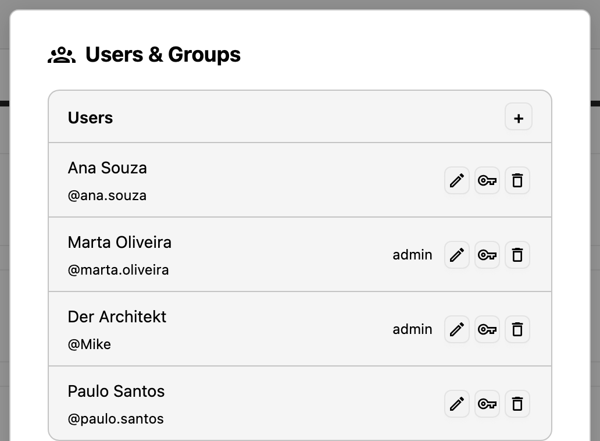
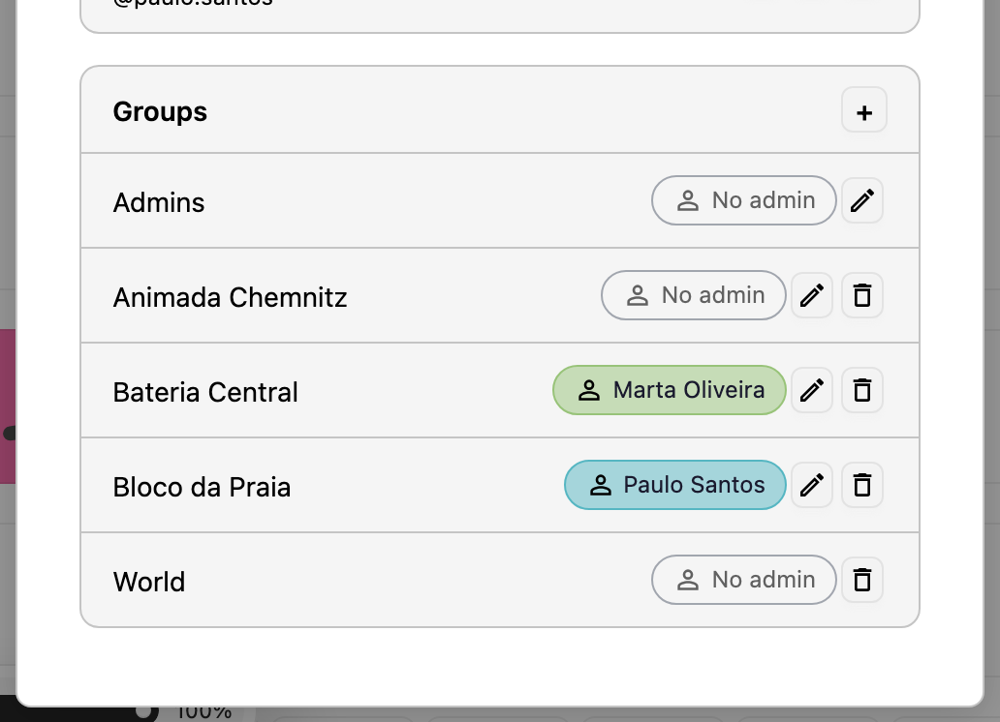
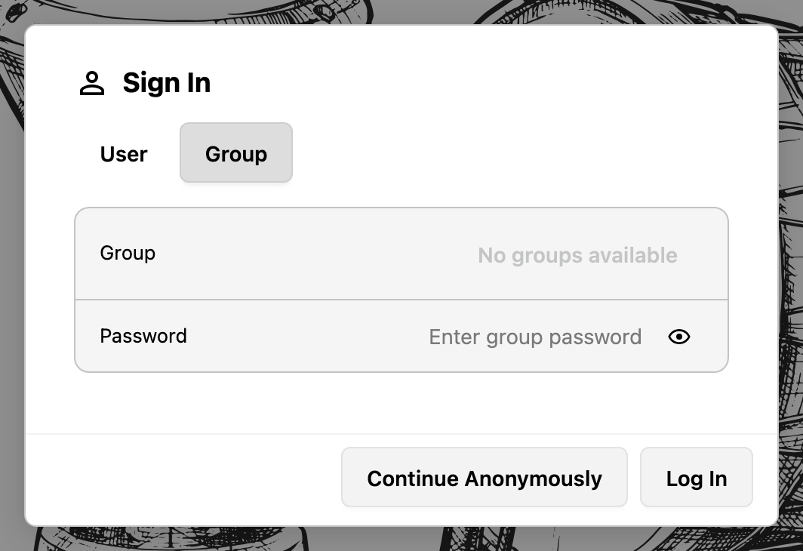

# Users, Groups and Permissions

Accounts decide who may read and change a score. The administration area for them is the `Users & Groups` dialog, reachable from the header's overflow menu. A user who is not an administrator sees the same dialog titled `My Groups`, without the `Users` tab, and can only change the groups they administer.

## The First Administrator

The first administrator is created right after the database has been initialized, in the `Finish Installation` dialog:

- `Admin User`: `Username`, `Password`, `Confirm`, and `Display Name`.
- `Initial Group`: a `Group Name` for the group that new users can be assigned to.

The account becomes a member of the `Admins` group, which is what grants administrative rights. [Installing Animada Score Book](installation.md) describes the dialog in its context.

## Users

The `Users` tab lists every account with its user name, display name, and an `admin` badge for members of the `Admins` group. `+` creates an account; each row offers `Edit`, `Reset Password`, and `Delete`.

The `Edit` dialog holds:

| Field              | Rules                                                           |
| ------------------ | --------------------------------------------------------------- |
| `Username`         | At least 3 characters, unique; cannot be changed after creation |
| `Display Name`     | Shown in the interface; defaults to the user name               |
| `Password`         | At least 6 characters; empty means "keep the current one"       |
| `Group Membership` | Any number of groups, entered as chips with autocompletion      |

`Reset Password` asks for a `New Password` with the same minimum length. Deleting an account removes it and its group memberships; the last member of `Admins` cannot be deleted.

*The users list: display name, `@user` handle, the `admin` badge where it applies, and `Edit`, `Reset Password`, and `Delete` per row.*

## Groups

The `Groups` tab lists the groups with their member counts. `+` creates one; each row offers `Edit Group` and `Delete Group`. The dialog holds:

| Field      | Meaning                                                                               |
| ---------- | ------------------------------------------------------------------------------------- |
| `Name`     | The group name, set at creation and unique                                            |
| `Admin`    | The group's administrator, chosen from the users; `None` leaves the group without one |
| `Password` | An optional shared password that enables group login                                  |
| `Members`  | The users in the group, with a filter to find them and a remove action per entry      |

A group administrator may manage that group without being an administrator of the installation.

*The groups list with the administrator chip per group: `Bateria Central` and `Bloco da Praia` have one, `Admins` and `World` cannot get one.*

## Group Login

When a group has a shared password, the `Sign In` dialog's `Group` tab accepts the group name and that password. This is meant for a shared device or a rehearsal room where nobody wants to type a personal password.

Behind the scenes three rules matter:

- A group login uses the shared `anonymous` account, so all group logins look like the same user to the backend.
- The session carries only that group, plus `World`; other group memberships of the account do not apply.
- Each account row holds one refresh token, so a new group login on the same server ends the previous group session.

*The `Group` tab asks for a group and its shared password. The dropdown reads `No groups available` while no group has a password.*

## The `Admins` and `World` Groups

Both groups always exist and behave differently from ordinary ones:

- `Admins` members bypass every permission check. The group's members can be edited, but the group cannot be deleted, cannot receive a password, and the last remaining admin cannot be removed.
- `World` is the public group. Every user and every anonymous visitor is a member of it automatically, so a score shared with `World` is publicly readable. The group itself cannot be edited or deleted.

## Ownership and Inherited Access

Every folder and score has an owner — the account that created it — and a set of group grants. Access is resolved in this order:

1. Administrators have full access to everything.
2. The owner of an entry has read and write access to it.
3. Group grants are collected for the entry and then for every folder above it, up to the top level. A grant on a parent folder therefore applies to everything inside it.
4. Along that chain a child can upgrade `read` to `write`, but a `write` grant from a parent is never downgraded to `read` further down.

`Write` always includes `read`. Anonymous visitors only hold what `World` grants them.

## The Group Access Editor

`Group Access` in a row's menu of the Score Library opens the editor for that entry. It shows the owner, the groups with `Read` and `Write`, and the remaining groups to drag in. [The Score Library](../using/score-library.md) describes the handling; this chapter describes the rules behind it.

## Resetting Inherited Access

`Reset Children`, available on folders in the permission editor, removes the explicit grants of every folder and score below that folder. All of them inherit from their parents again, while the folder itself keeps its own grants. Use it after reorganizing a folder tree, when moved entries would otherwise carry stale grants with them.

## Resetting the Database

The `Reset Database` action in the `Backend Setup` dialog drops every table and rebuilds the schema through the migrations. Afterwards the seed data and the shared `anonymous` account are created again, and the `Finish Installation` dialog appears, just as on a fresh installation.

That deletes every user, group, grant, and score. Export the scores you need and take a database backup first; [Backup, Restore and Upgrades](backup-restore-upgrades.md) explains how.

## Known Limits

- Neither list is paginated; large installations need a database query for an overview.
- There is no self-service password change and no session or device management, so a forgotten password always goes through `Reset Password` by an administrator.
- The `login_audit` table records logins and group logins, but no view in the application reads it.
- The permission editor never gives `World` write access; the backend does not enforce that rule itself.

## Related Chapters

- [The Score Library](../using/score-library.md) explains where the permission editor and the indicators appear.
- [Security Notes](security.md) covers passwords, tokens, and brute-force limiting.
- [Backup, Restore and Upgrades](backup-restore-upgrades.md) covers backups before a reset.
