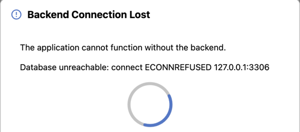
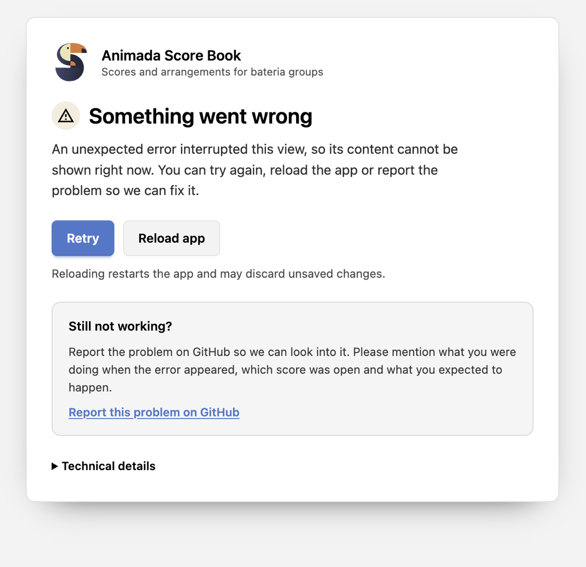

# Troubleshooting and Known Limitations

This chapter lists the problems that occur in practice, with their cause and remedy, and collects what the 2.0.1 release documents instead of fixing.

## The Backend Is Unreachable

When the browser cannot reach the backend at startup, it shows `Server Unreachable` with `The Animada Score Book server could not be reached. Make sure the backend is running and try again.` and a `Retry` button. A failure while loading configuration appears as `Connection Error` with the message from the backend. Check, in this order:

1. Is the process running? The start log ends with `Backend server listening on http://…`.
2. Does the address in the browser match `host` and `port` from `backend-config.json`?
3. Is the database reachable? Without it the process keeps running but cannot answer.
4. Is a firewall or the hosting environment blocking the port?

The process exits immediately when the port is taken: `Port <port> is already in use.`

## The Page Shows `Not found`

A deployment that answers every address with the plain text `Not found` is reaching the backend, but the process was started in the wrong directory. Every path the backend serves is relative to its working directory: `dist/index.html`, `public/`, `migrations/`, `build/seed.sql`, and `backend-config.json`. Started inside the `dist` subdirectory, it looks for `dist/dist/index.html` and `dist/backend-config.json`, finds neither, and answers `404` with that text.

The health endpoint names the cause instead of hiding it:

```json
{"configLoaded":false,"configError":"No backend-config.json found. Missing database settings: database.host, database.port, database.database, database.user.","engine":"mysql","host":"","port":0,"database":"","status":"error","dbStatus":"db_unreachable","initialized":false,"hasData":false,"hasUsers":false}
```

`configLoaded: false` together with that `configError` means the process could not read `backend-config.json` from its working directory. The database is not the problem; the `Database unreachable` line is only a consequence of the empty connection settings.

To fix it:

1. Start the process in the package directory, where `server.js`, `dist/`, `public/`, `migrations/`, `build/`, and `backend-config.json` sit — not in `dist`. [Installing Animada Score Book](administration/installation.md#running-the-backend-on-a-server) states both requirements of a deployment.
2. Route the domain to that process, for example through a reverse proxy on its port. `/api`, `/soundLib/`, and `/public/uploads/` are answered by the backend only, so a document root that points at `dist` cannot serve the application.
3. `https://<host>/api?action=health` should then report `"status":"ok"` with `"configLoaded":true` and `"initialized":true`.

The opposite misconfiguration has the opposite symptom: a statically served `dist` loads the interface, which then reports `Server Unreachable` because it cannot reach `/api`.

## The Connection Is Lost during a Session

A broken connection during work opens a dialog with `Reconnecting… (attempt <n>)`. The application retries every three seconds and closes the dialog shortly after the backend answers again. Unsaved changes stay in the browser and are not lost; save once the connection is back.



*`Backend Connection Lost` with the underlying error underneath; the spinner is the reconnect attempt that runs every three seconds.*

## An Unexpected Error

When a view fails while rendering, the application replaces the whole interface with an error page instead of leaving a blank window:



*An unexpected error replaces the application with this page: `Retry` renders the view again, `Reload app` restarts the application, and `Technical details` holds the message and stack trace for a report.*

- `Retry` renders the view again, which often is enough after a temporary problem. `Reload app` restarts the application; unsaved changes may be lost.
- `Still not working?` links to the GitHub issue tracker. Mention what you were doing and which score was open.
- `Technical details` holds the application version, the error message, and the stack trace, with `Copy details` to put them on the clipboard. Bearer tokens, passwords, and tokens in URLs are masked before they are shown.

## The Installation Cannot Be Completed

| Message                                                                    | Cause and remedy                                                                                             |
| -------------------------------------------------------------------------- | ------------------------------------------------------------------------------------------------------------ |
| `Backend configuration is missing or invalid.`                             | `backend-config.json` is missing, unreadable, or lacks database settings. Fix it and restart the process.    |
| `Could not auto-connect: …` followed by `Waiting for setup from frontend…` | The database connection failed. Correct the database block in `backend-config.json` and restart the process. |
| `backend-config.json is not valid JSON`                                    | The dialog shows the parse error. Repair the JSON in the file and restart the process.                       |
| `The database schema is incomplete.`                                       | Tables of an older schema, or a half-migrated database. Choose `Reset Database` in the same dialog.          |
| `Port <port> is already in use.`                                           | Another process holds the port. Stop it or change `port`.                                                    |

## Login Failures and Lockout

- `Invalid group name or password` is returned both for an unknown group and for a wrong password. Check the group name first, then the shared password.
- After seven failed attempts for the same client address and account, the backend answers `Too many attempts. Try again later.` for 15 minutes. A restart clears the counters; a successful login clears them too.
- Behind a proxy that is not configured with `trustProxy`, every user shares the proxy's address, so one lockout affects everyone. See [Configuring the Backend](administration/configuration.md).
- Over plain HTTP the browser discards the `Secure` refresh cookie, so the session ends after 15 minutes even though it worked before. Use HTTPS.
- When the session has ended, the application says `Your session has ended — log in again to save this score.` or `Your session has ended. Log in again to edit.`

## Permission Errors

- `You do not have permission to edit this score.` and `You do not have permission to save this score.` mean that the account has no write access. The owner, a group grant, or an administrator is needed; [Users, Groups and Permissions](administration/users-groups-permissions.md) explains how access is resolved.
- `You do not have permission to save this score.` also appears when a score was opened through a link and the account may only read it.
- Without a signed-in account, editing itself works: the changes stay in the browser and `Save Score` reports `Sign in to save this score.`

## A Score Is Locked

`Score is being edited by <user> (since <date and time>)` means someone else is in edit mode on that score:

- The lock lasts 30 minutes and is released when the other editor saves or leaves edit mode.
- Waiting is the only option today; there is no way to break a lock from the interface.
- The lock is a courtesy. Saving is last-write-wins, so coordinate outside the application if both editors must keep working.

## Missing Sounds or Music Fonts

- If notes play silently or a single instrument has no sound, the sound library is incomplete or `soundLibPath` points at the wrong directory. The samples ship in `public/sounds`; a changed path requires a restart.
- `The selected music font could not be loaded.` means the font files are missing or damaged. Choose another font in `Settings`; the package ships all fonts it offers.

## Export Problems

- `The MP3 could not be exported. Please try again.` appears when the browser cannot encode MP3 or rendering fails. Chromium-based browsers are what the export is tested with.
- An MP3 contains the whole score: looping is ignored and a Play Focus range is not exported.
- PDF output comes from the browser's print dialog; the application does not create PDF files itself.

## The Print Output Differs from the Preview

Compare these settings:

1. Paper size A4 and the orientation chosen in the preview.
2. Browser scale at 100 %; the print scale in the preview is what sizes the notation.
3. Browser headers and footers switched off; the document brings its own title, margins, and page numbers.
4. No additional browser margins.

## Known Limitations

| Area             | Limitation                                                                                                     |
| ---------------- | -------------------------------------------------------------------------------------------------------------- |
| Zoom             | Manual only, 50 % to 150 %; no pinch or wheel zoom. `Fit width` and `Fit page` exist in the print preview only |
| Dynamics         | Placeable only in the staff view in edit mode                                                                  |
| Instruments      | Defined in code; there is no instrument administration and no per-install sound library interface              |
| Auditing         | `login_audit` is written but no view reads it                                                                  |
| Accounts         | No self-service password change and no session or device management                                            |
| Backups          | No backup or restore tooling in the application; `build/dump-seed.ts` covers folders and scores only           |
| Database engines | No migration path from MySQL to PostgreSQL or back                                                             |
| Score history    | Scores are stored as one block per save; no version history, and concurrent saves are last-write-wins          |
| Sessions         | Undo history and playback position are session-only                                                            |
| PDF              | No in-app PDF generation                                                                                       |
| MP3              | Needs browser MP3 encoding; no loop and no range export                                                        |
| Group login      | Group logins share the `anonymous` account, and a new group login ends the previous group session              |
| Score locks      | 30 minutes, no heartbeat, released only on save or leaving edit mode                                           |
| Anonymous access | Anonymous visitors see every score shared with `World`                                                         |
| Lists            | User and group lists are not paginated                                                                         |
| HTTPS            | The backend itself serves HTTP; the refresh cookie requires TLS in front of it                                 |
| Migration files  | A migration file changed after it ran blocks the start; there are no down migrations                           |

## Related Chapters

- [Security Notes](administration/security.md) explains sessions, cookies, and rate limiting.
- [Installing Animada Score Book](administration/installation.md) covers configuration errors and the setup dialog.
- [Printing, PDF and MP3 Export](using/printing-and-export.md) describes the output itself.
