# Reading a Score: Grid View, Staff View, Fonts and Themes

This chapter is about looking at a score rather than changing it: the two presentations, the font and color choices, and the controls that help on a screen of any size.

## Grid View

The grid view lays the score out as a matrix:

- Every bar is a column, every track is a row.
- Each cell carries one symbol, colored per track, so a rhythmic pattern appears as a shape.
- All bars of the score are rendered, which makes the grid the faster view for scanning a whole piece.

The grid is described for editing in [Editing in the Grid View](grid-editing.md); the presentation aspects are the symbol per cell and the color that identifies the track.

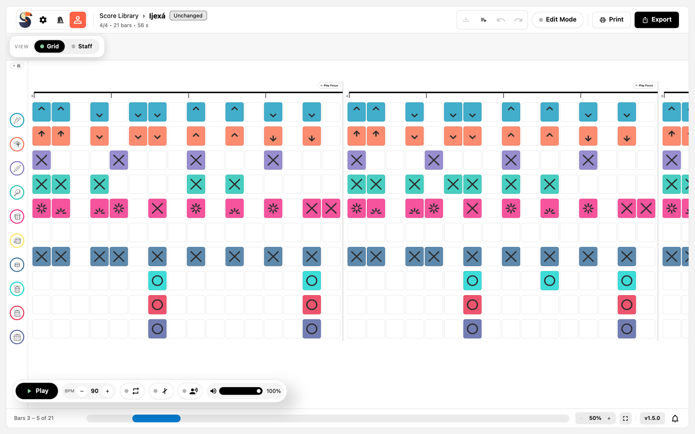

*Bars 3 to 5 of Ijexá in the grid view: one symbol per step, colored per track.*

## Staff View

The staff view shows percussion notation:

- Each track gets its own staff row with a percussion clef.
- Note values, rests, stems, beams, and tuplets are drawn as in printed music.
- Articulations such as accents, ghost parentheses, and damped marks sit next to the noteheads.
- The time signature is shown at the beginning, and repeat barlines appear where the score has them.

This is the view most players read, and it is what the print output uses.

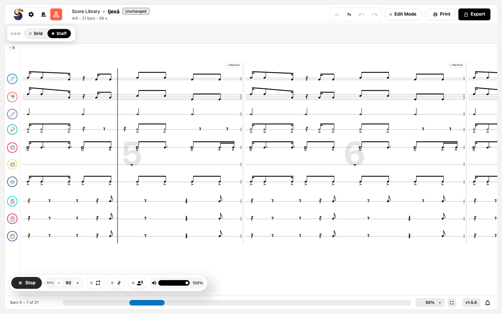

*The same passage as staff notation during playback; the blue line is the playhead, the footer names the visible bars.*

## Switching Between the Views

The mode bar near the score carries two segments:

| Segment | Tooltip                                | Shortcut |
| ------- | -------------------------------------- | -------- |
| `Grid`  | `Show the score as a note grid (G)`    | `G`      |
| `Staff` | `Show the score as staff notation (S)` | `S`      |

The shortcuts work whenever the focus is not in a text field. Switching is possible during playback and keeps the position in the score. The last chosen view is remembered in your browser.

## Music Fonts

`Settings` → `Music font` decides which SMuFL font draws notes, rests, clefs, and barlines:

| Font        | Notes                     |
| ----------- | ------------------------- |
| `Bravura`   | The default, by Steinberg |
| `Eugene`    | By Mikko Patama           |
| `Gootville` |                           |
| `Leipzig`   |                           |
| `Leland`    |                           |
| `Petaluma`  |                           |
| `Sebastian` |                           |

Each font brings its own engraving metrics, so spacing and notehead shapes change with it; playback is unaffected. The info button next to the list shows the font's version, copyright, licence, and source. All bundled fonts are licensed under the SIL Open Font License.

The dropdown draws every entry as a sample in that font, so you can compare them before choosing.

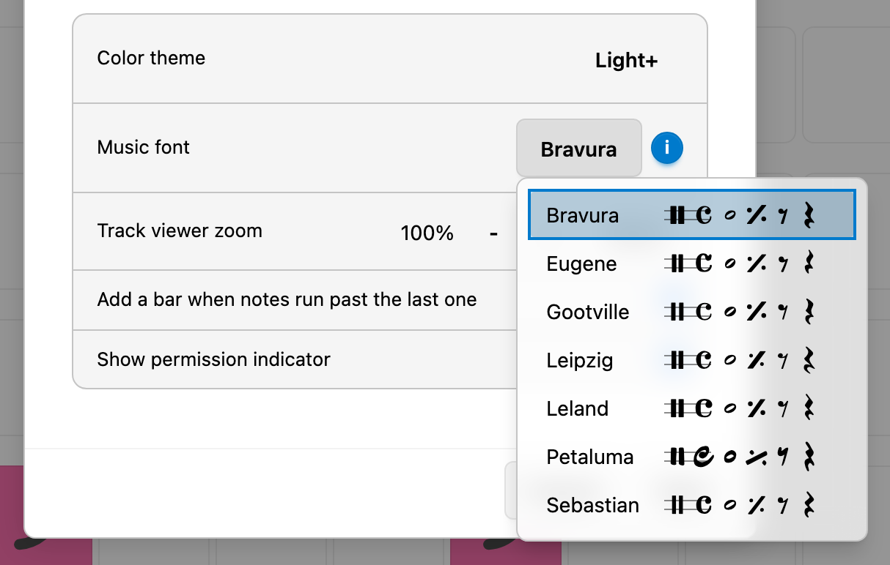

*The picker draws each font name in the font itself, so the comparison starts before the choice.*

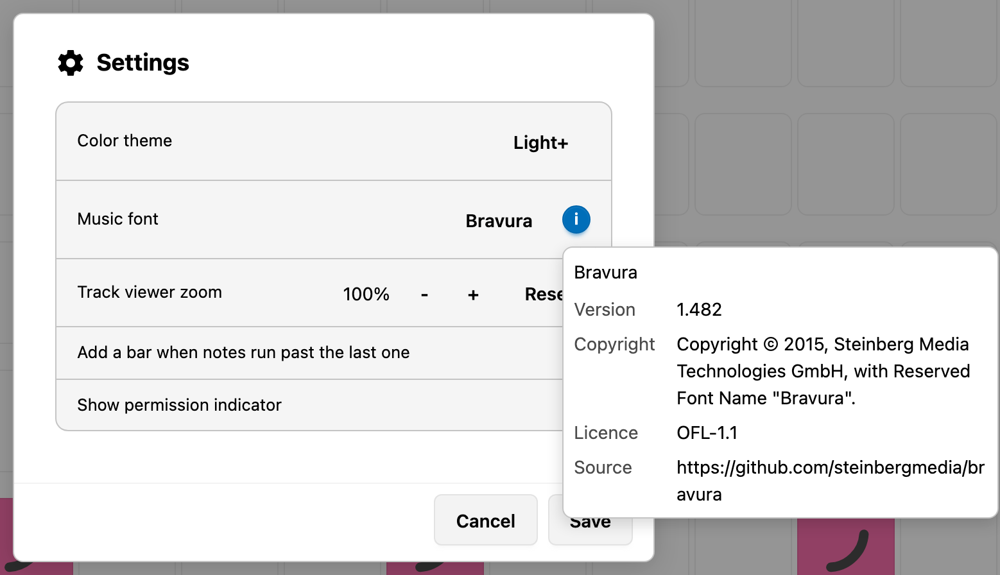

*The info button beside the picker states version, copyright, licence, and source of the selected font; here Bravura 1.482.*

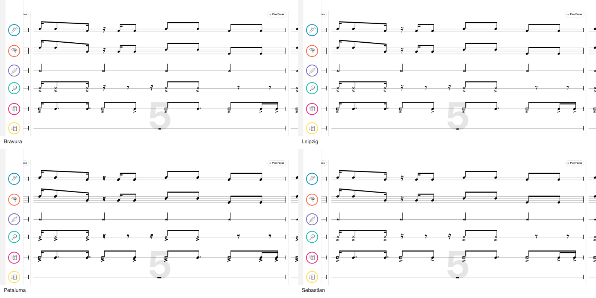

*One bar of Ijexá in four of the bundled fonts: Bravura (default), Leipzig, Petaluma, and Sebastian.*

## Color Themes

`Settings` → `Color theme` offers:

- `Auto`, which follows the operating system's light or dark setting.
- Four light themes: `Light+`, `Light High Contrast`, `Quiet Light`, `Solarized Light`.
- Nine dark themes: `Dark+`, `Dark High Contrast`, `Abyss`, `Kimbie Dark`, `Monokai`, `Monokai Dimmed`, `Red`,
  `Solarized Dark`, `Tomorrow Night Blue`.

A theme changes the colors of the interface. The choice is stored in your browser and applies to the next start as well.

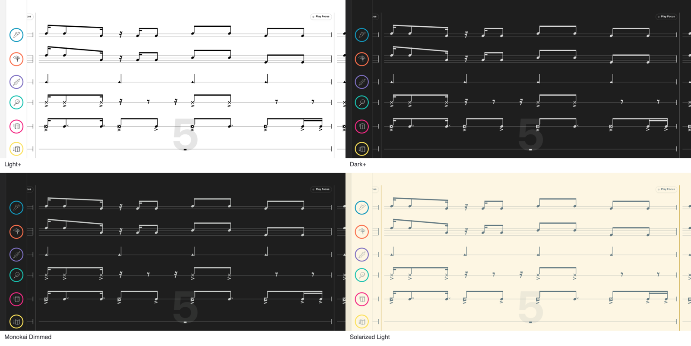

*Two light and two dark themes on the same bar: `Light+`, `Dark+`, `Monokai Dimmed`, and `Solarized Light`.*

## Zoom

The track viewer zoom scales the score area and is available in two places:

- The footer's `Zoom out` and `Zoom in` buttons.
- `Settings` → `Track viewer zoom`, together with a `Reset` button.

The range is 50 % to 150 % in steps of 10, with 100 % as the default. Zoom is manual: there is no pinch or wheel zoom. `Fit width` and `Fit page` exist only in the print preview.

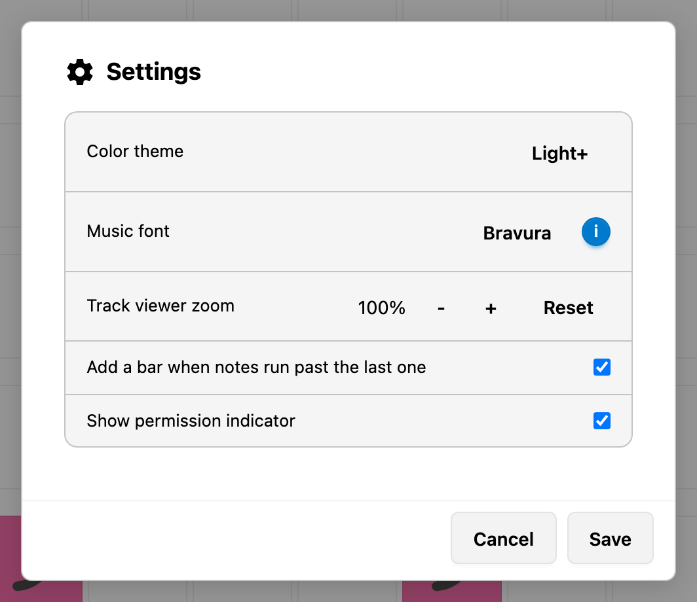

*The whole Settings dialog: colour theme, music font, track viewer zoom with `Reset`, the auto-extend switch, and the permission indicator.*

## The Score Navigator

The footer shows where you are and lets you jump:

- The caption reads `Bar 5 of 32`, or `Bars 5 – 9 of 32` when more than one bar is visible.
- The strip next to it represents the whole score; dragging it moves the viewport.

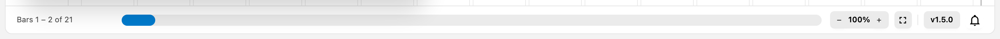

*The footer from left to right: the visible bars, the navigator strip, the zoom stepper, Zen mode, the version button with the release notes, and the bell of the notification center.*

## Release Notes

The version button at the right end of the footer opens the release notes: every released version, newest first, each
with a short list of its changes. `Close` returns to the score. The notes belong to the running build, so they describe
the version the button names.

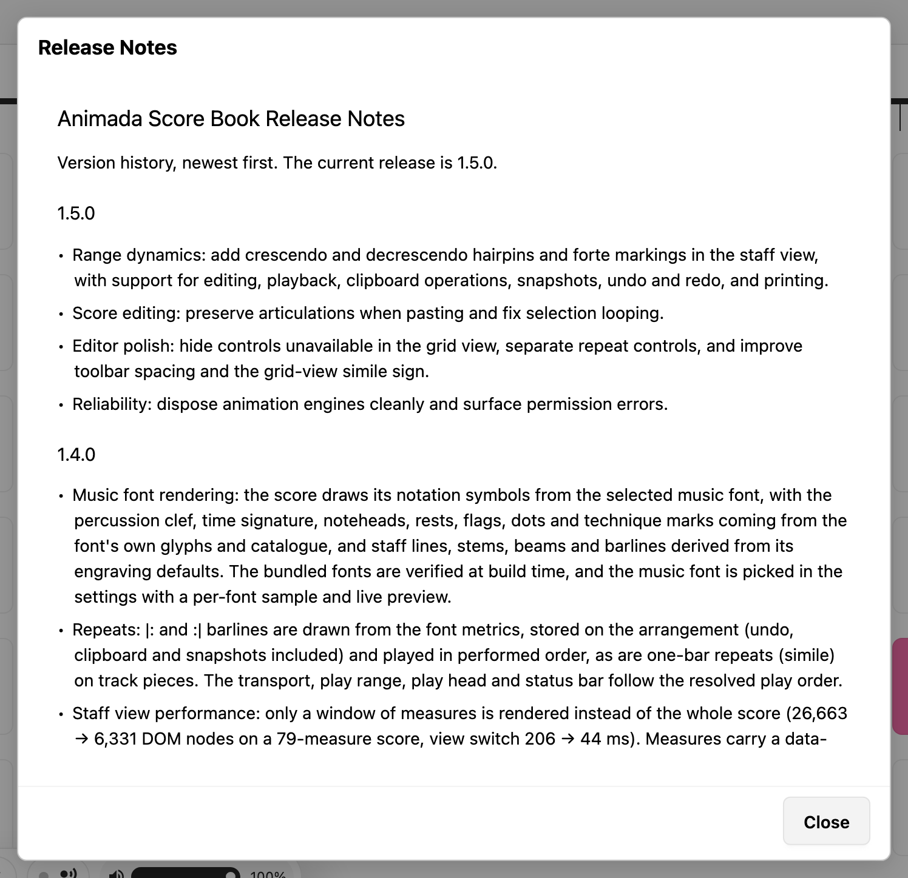

*The release notes dialog, opened from the version button: the version history, newest first, with `Close` at the bottom right.*

## Zen Mode

`Enter Zen mode` in the footer reduces the screen to the score:

- The header and the mode bar disappear, and the score title moves above the notation.
- The track column keeps the instrument names only.
- Editing is not available while Zen mode is active.
- Dragging with the pointer pans the score in both directions.

The same footer button then reads `Exit Zen mode` and restores the full layout. `Escape` clears the selection outside Zen mode but does not leave Zen mode.

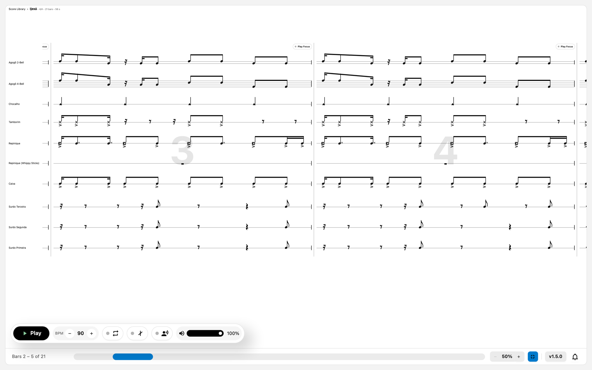

*Zen mode: no header, no mode bar, instrument names only in the track column.*

## Phones and Tablets

The layout adapts to the available width:

- On narrow screens the playback bar folds loop, metronome, count-in, and volume into the `More playback controls` menu,
  and the footer folds zoom and the version button into a menu of their own.
- The Score Library opens as a drawer over the score instead of beside it.
- The score area keeps the same views, so both grid and staff remain usable.

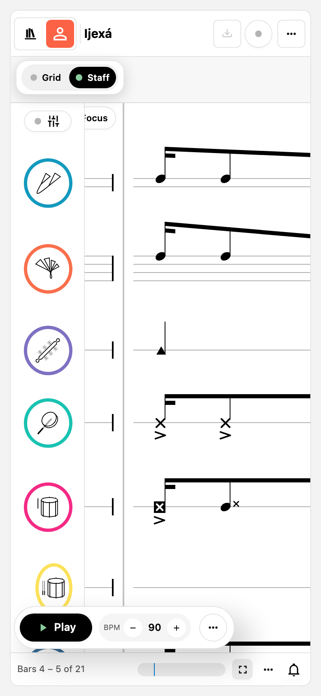

*390 pixel wide: the mode bar above the score, the ticker labels reduced to icons, and the playback bar folded to `Play`, tempo, and a menu.*

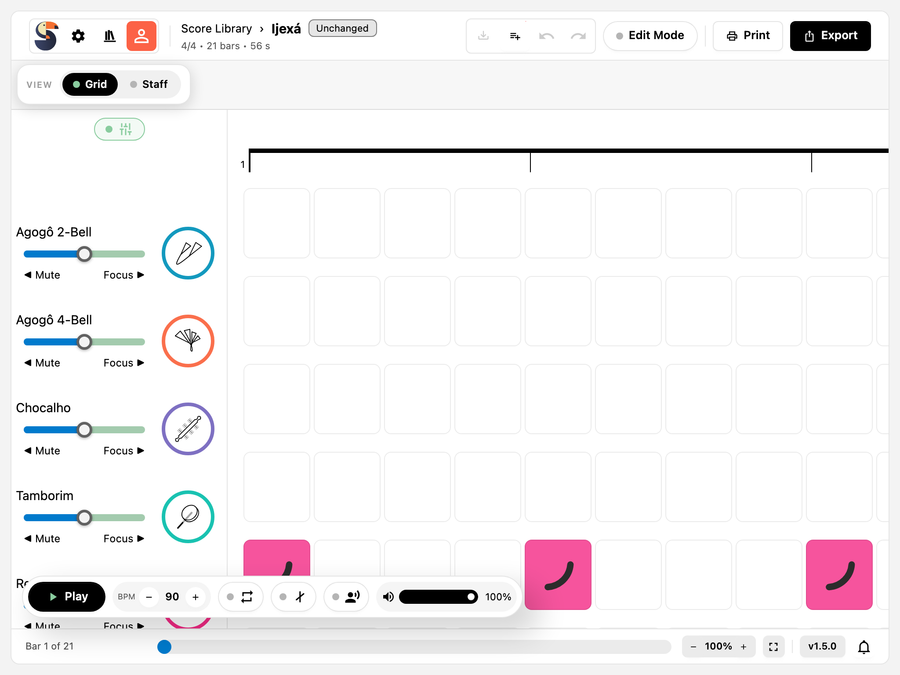

*1024 pixel wide: the header keeps every action, the mixer stays expanded beside the score.*

## The Notification Center

Messages appear as toasts and are collected behind the bell button in the footer:

- The button's tooltip counts new messages, for example `2 new notifications`.
- Pressing it opens the history of earlier messages; pressing it again, or `Hide notifications`, closes it.
- A do-not-disturb state suppresses ordinary messages; errors are still shown.

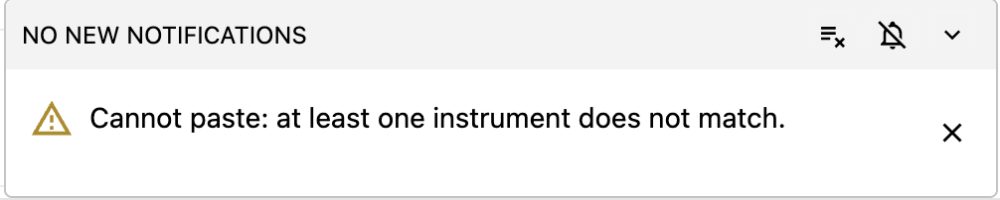

*The history with its clear-all, do-not-disturb, and hide controls; the header counts the messages that are still new.*

## Related Chapters

- [Editing in the Staff View](staff-editing.md) and [Editing in the Grid View](grid-editing.md) cover changing the score
  in either presentation.
- [Instrument and Notation Reference](../instruments.md) explains the symbols you see.
- [Printing, PDF and MP3 Export](printing-and-export.md) covers the printed result.
