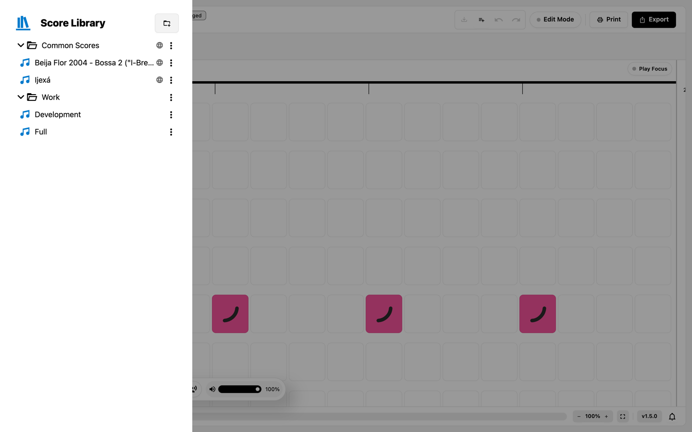
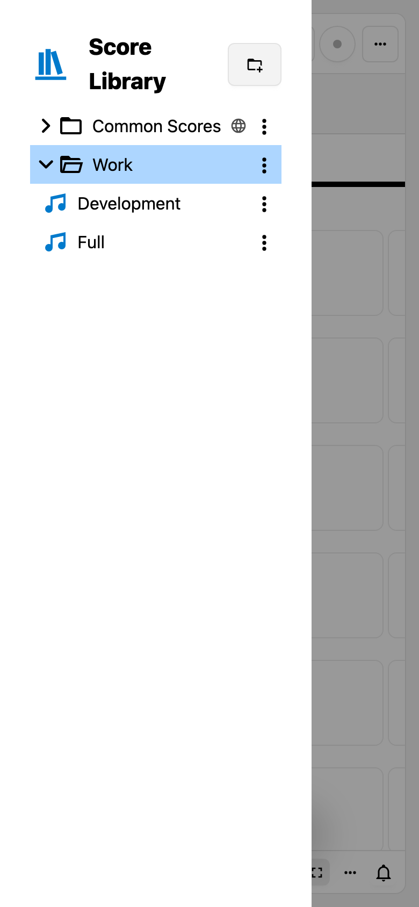
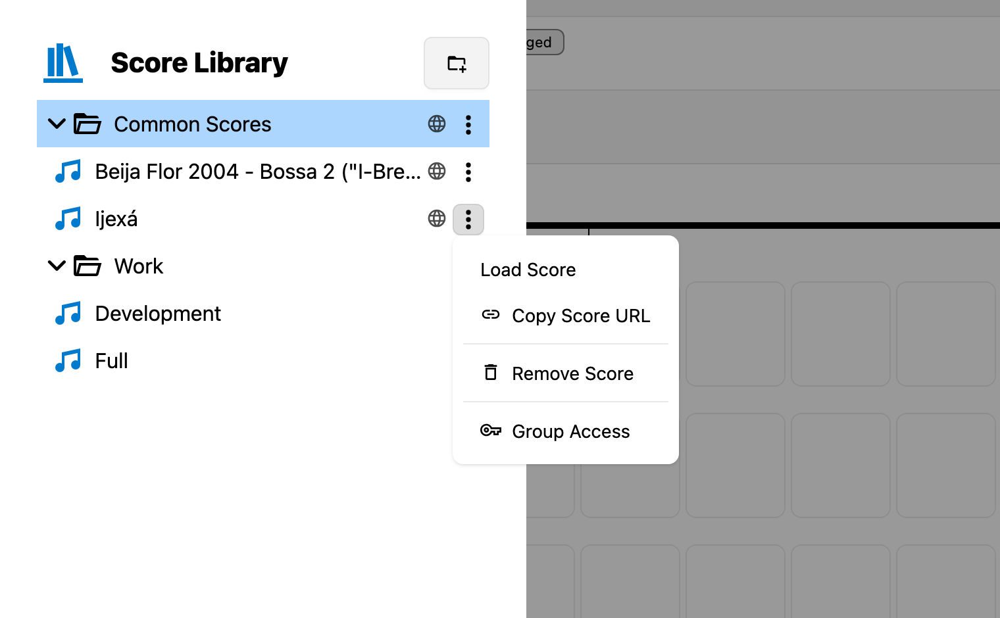
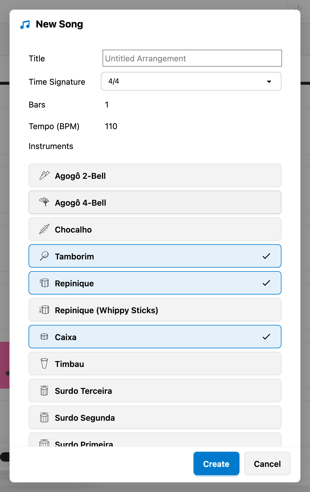
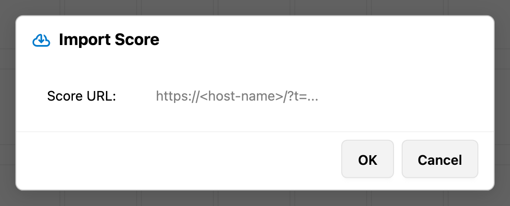
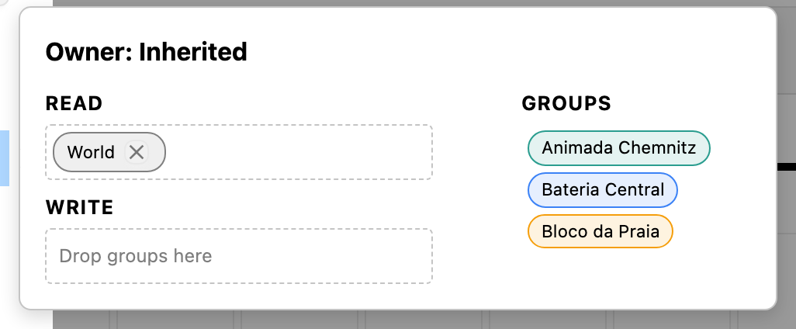

# The Score Library

The Score Library is the drawer that holds every score you can reach. It organizes scores in folders, opens them for playback and editing, hands out share links, and shows who may change an entry.

## Opening the Library

Press the `Score Library` button in the header. The library opens over the score area, so the score stays loaded while you browse. Press `Escape` or click outside the drawer to close it.

The drawer's title row carries the `Add New Folder` button, which creates a folder at the top level.

*The drawer over the score: folders, their scores, and the globe that marks an entry shared with `World`.*

On a phone the drawer takes most of the width, and the score stays dimmed behind it:

*The library on a 390 pixel wide screen: the title row, the folders, and the row menus stay reachable.*

## Browsing Folders and Scores

Every row shows an icon, the entry name, a permission indicator when the entry is special, and a menu button at its right end:

- **Folders** have a closed or open folder icon and hold other folders and scores.
- **Scores** have a music icon.
- Rows in a loading state show a progress indicator until their contents arrive.

*The menu of a score row: `Load Score`, `Copy Score URL`, `Remove Score`, and `Group Access`.

Double-click a score, or choose `Load Score` from its menu, to open it. The drawer closes and the score replaces the one currently loaded.

## Creating Folders

- `Add New Folder` in the library title row creates a top-level folder.
- `Add New Sub Folder` in a folder's menu creates a folder inside it.

Both open the `Add New Folder` dialog with a single `Name` field. An empty name is ignored.

## Creating a Score

`New Score` in the header opens the `New Song` dialog:

| Field            | Meaning                                                                                  |
| ---------------- | ---------------------------------------------------------------------------------------- |
| `Title`          | The score's name; the placeholder is `Untitled Arrangement`                              |
| `Time Signature` | `4/4`, `6/8`, `5/4`, or `7/8`                                                            |
| `Bars`           | The number of bars the new score starts with                                             |
| `Tempo (BPM)`    | The tempo stored in the score                                                            |
| `Instruments`    | One entry per instrument; `Select All` and `Unselect All` help; at least one is required |

The dialog remembers the time signature, tempo, bar count, and instrument selection per browser. `Create` starts the new score in edit mode.

*`New Song` with `Tamborim`, `Repinique`, and `Caixa` selected; `Create` starts the score, `Cancel` leaves the current one untouched.*

A new score exists only in your browser at this point. The first `Save Score` creates the entry in the library, at the top level, and from then on the score is served by the backend like any other.

`New Score` is disabled while edit mode is active, because leaving edit mode is what saves and unlocks the current score.

## Importing a Score

A folder's menu opens `Import Score` with a single `Score URL` field. It accepts a BananaDrum share link (`https://<host-name>/?t=...`) and is pre-filled from the clipboard when the clipboard holds a URL. The import creates a new score inside that folder, named after the link's `t` parameter, or `Imported Score` when the parameter is missing.

*`Import Score` asks for one URL; `OK` imports it into the folder the menu belongs to.*

## Sharing a Score

`Copy Score URL` in a score's menu copies a link of the form `https://<host>/?score=<id>` and confirms it with `Score URL copied to clipboard.` The link opens the score directly; whether the recipient can open it depends on the permissions described below.

## Renaming and Removing Entries

- `Rename Folder` opens a dialog with the current name as its starting value. Renaming a score happens through its title
  while edit mode is active.
- `Remove Folder` removes a folder, but only while it is empty.
- `Remove Score` deletes a score.

Removal asks for confirmation with the entry name, the buttons `Delete` and `Cancel`, and two hints: the action cannot be undone, and you should export the content if you want to keep a copy. Export the score as PDF or MP3 before removing it if you may need it again.

## Permission Indicators

The indicator next to a name shows only exceptional states:

| Indicator        | Meaning                                                |
| ---------------- | ------------------------------------------------------ |
| `Read-only` mark | You may open and play the entry but not change it      |
| Globe            | The entry is in the `World` group and therefore public |
| none             | You may write the entry and it is not public           |

Owners and administrators get a `Group Access` tooltip on the indicator and can click it to open the permission editor. The indicator can be turned off with the `Show permission indicator` setting.

## The Group Access Editor

`Group Access` in a row's menu opens the editor for that entry:

- The header names the owner, or `Inherited` when the entry takes its permissions from its parent.
- `Read` and `Write` list the groups that hold that access; each chip can be removed again.
- `Groups` lists the remaining groups. Drag a group onto `Read` or `Write` to grant access.
- `Write` always includes read access, and the editor keeps the `World` group read-only.
- `Reset Children`, available on folders, removes the explicit permissions of every folder and score below that folder,
  so all of them inherit again. The folder itself keeps its own permissions.

*`Read` holds `World`, `Write` is still empty, and the remaining groups wait on the right to be dragged in.*

[Users, Groups and Permissions](../administration/users-groups-permissions.md) explains the underlying model, group passwords, and the `Admins` and `World` groups.

## Who May Do What

The backend decides, not the browser:

- **Read access** lets you open, play, print, and export a score.
- **Write access** is required to enter edit mode, to save, to remove entries, and to create folders or imports inside a
  folder.
- **Ownership** adds the `Group Access` editor.
- **Administrators** may manage and remove every entry and every permission.
- **Anonymous visitors** see every entry in the `World` group and nothing else.

Trying to edit a score without write access ends the attempt with `You do not have permission to edit this score.` Without a signed-in account — as an anonymous visitor, or with a session that has ended — the application says `Your session has ended. Log in again to edit.` and opens the sign-in dialog instead.

## Score Locks

Entering edit mode locks the score on the backend, so two editors do not overwrite each other silently:

- If someone else holds the lock, edit mode does not start and the application reports `Score is being edited by <user>
  (since <date and time>)`.
- Locks expire after 30 minutes and are released when the score is saved or when you leave edit mode.
- A lock is a courtesy, not a guarantee: the last save wins. The [Security Notes](../administration/security.md) list
  this and the other limitations.

If a score was removed on the backend while you have it open, saving recreates it as a new entry.

## Related Chapters

- [Your First Session](../getting-started/first-steps.md) shows the whole path from signing in to saving.
- [Users, Groups and Permissions](../administration/users-groups-permissions.md) explains groups and access rules.
- [Reading a Score](presentation.md) covers the views the library opens scores in.
