# Editing in the Staff View

The staff view is where notes are written. Editing needs edit mode, which locks the score for other editors, and every change counts as one undo step and marks the score as having unsaved changes.

This chapter follows a session: entering edit mode, placing notes, shaping them, and putting structure around them.

## Entering Edit Mode

The `Edit Mode` switch in the header turns into `Editing` when edit mode is active. Three things happen at that moment:

- The score is locked, so a second editor is told `Score is being edited by <user> (since <date and time>)`.
- The editor adds a visible cursor, a bar action strip above the bars, and an action button on every track row.
- The mode bar gains an `Entry` section next to `View`.

Edit mode requires write access. Without it, the attempt ends with `You do not have permission to edit this score.` If your session has ended, the application asks you to log in again.

`Save Score` in the header, or `Ctrl`/`Cmd`+`S`, writes the score to the backend. Leaving edit mode saves first and releases the lock; a failed save keeps you in edit mode so nothing is lost.

*Edit mode: the mode bar offers `Entry`, the bar action icons sit above the bars, and a selected note opens the note style popup.*

## Entering Notes

Notes are entered at the cursor:

1. Click a position in the score, or move the cursor with the arrow keys. The cursor moves across bars and tracks and
   wraps at the ends.
2. Choose a note style. Keys `1` to `9` enter the style in that position of the instrument's list, and the note style
   section of the toolbar does the same by name.
3. Choose a note value before or after entering; the length applies to the note at the cursor.

`0` enters a rest, `Delete` and `Backspace` remove the note or rest at the cursor. Note values, beams, flags, and stem directions follow the values you enter and the grouping the bar produces.

## Note Values and Dots

The `Note value / duration` section offers whole, half, quarter, eighth, sixteenth, and thirty-second notes. The dotted value is a toggle, and both are also reachable by keyboard:

| Shortcut                          | Effect                                     |
| --------------------------------- | ------------------------------------------ |
| `Alt`/`Cmd`+`1` … `Alt`/`Cmd`+`6` | Set the length from whole to thirty-second |
| `Alt`/`Cmd`+`.`                   | Toggle the dot of the current value        |

The note length toolbar exists only in the staff view; the grid view works with fixed steps.

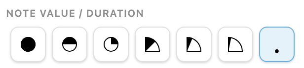

*Whole to thirty-second in the note value row, with the dot toggle at the right in its active state.*

## Rests

A rest is entered like a note, with `0` or the rest button. Rests keep their length and can be selected and changed like notes. A bar without content shows a whole-bar rest, and a run of rests stays visible and selectable instead of disappearing.

## Note Styles and Playing Techniques

Every instrument brings its own list of note styles, and the `Note style & technique` section lists them for the track the cursor is in. A style decides both the sound and the symbol, so choosing `Slap` on a Timbau changes what you hear and what is drawn. [Instrument and Notation Reference](../instruments.md) describes the styles per instrument.

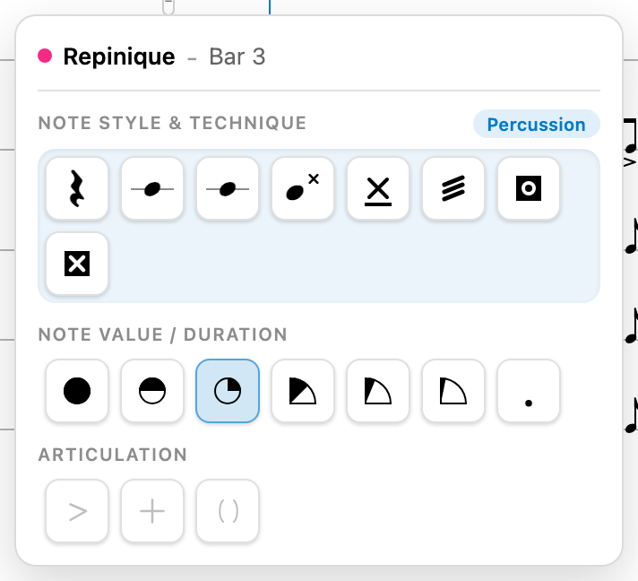

*The card of a Repinique track in bar 3: eight styles, the note value row, and the articulations the instrument offers.*

## Articulations

The `Articulation` section offers `Accent`, `Damped`, and `Ghost`. Which of them are available depends on the instrument's styles; the marks are drawn next to the notehead without changing the chosen style. The button that is active applies to the notes at the cursor, and choosing another button replaces the mark.

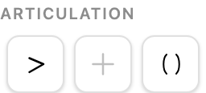

*`Accent`, `Damped`, and `Ghost` as buttons; the two the instrument has no variant for stay greyed out.*

## Overwrite and Insert

The `Entry` section of the mode bar decides what a new note does to the content behind the cursor:

| Mode        | Tooltip                                                    | Key |
| ----------- | ---------------------------------------------------------- | --- |
| `Overwrite` | `Enter notes by replacing the content at the cursor (O)`   | `O` |
| `Insert`    | `Enter notes by pushing the content behind the cursor (I)` | `I` |

The chosen mode is remembered in your browser. The grid view always works in overwrite mode, because its raster has no room to push.

*The mode bar: `View` switches between grid and staff, `Entry` between overwrite and insert.*

## Selecting

Selection is the handle for everything that acts on existing content:

- Click a note to select it.
- `Shift`-click adds further notes to the selection.
- Drag a rectangle to select the note groups it covers.
- `Escape` clears the selection.

A range selection always starts on an existing note: the first note anchors the selection, and the rectangle or the
next `Shift`-click only extends it. Starting on an empty cell merely places the entry cursor.

The selection keeps the granularity of the element you touched first: a selection that started on a note stays a note selection, one that started on a whole bar stays a bar selection.

A selection that covers whole bars of a track opens the track piece toolbar with the one-bar repeat and the clear action. A selection of notes opens the toolbar card with note styles, values, articulations, and tuplets.

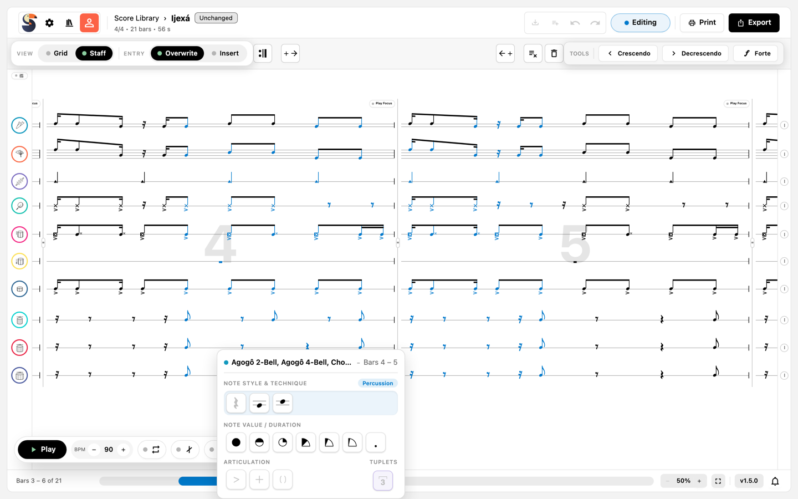

*A selection over two bars of the Agogô tracks; the card for the selected notes opens below.*

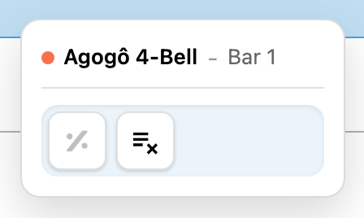

*A whole-bar selection keeps two actions: the one-bar repeat and clear.*

## Subdivisions and Tuplets

A subdivision divides a position into a tuplet. `Add subdivision` offers eight ratios: Duplet, Triplet, Quadruplet, Quintuplet, Sextuplet, Septuplet, Octuplet, and Nontuplet. Subdivisions can be nested: select a note inside a subdivision and add another one, and the new tuplet sits inside that slot. The label of the outer tuplet is drawn above the group, the label of a nested one below it.

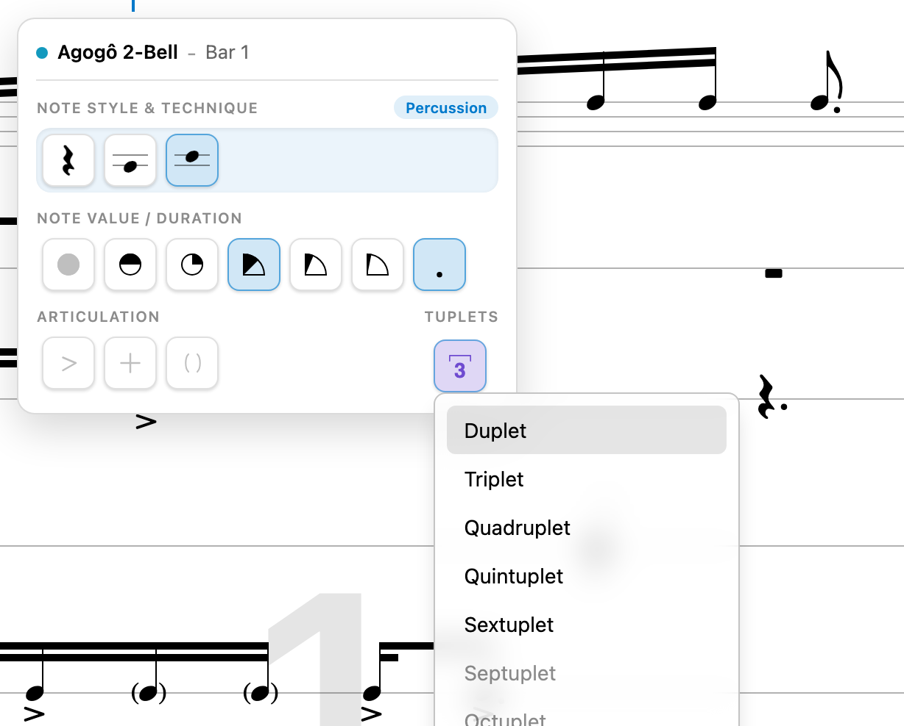

*`Add subdivision` opens the ratios from a duplet downward; the list continues below the visible part of the card.*

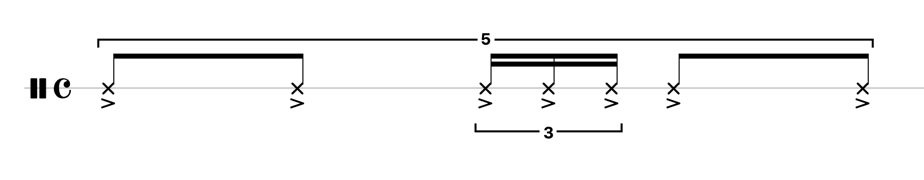

The subdivision is one block while it exists: notes inside it are addressed within the tuplet, not in the bar's plain step grid.

Copying a subdivision and pasting it into a different span asks how to apply it:

| Answer                 | Result                                                             |
| ---------------------- | ------------------------------------------------------------------ |
| `New Subdivision`      | The copied notes become a new subdivision inside the selected span |
| `Tile Subdivision`     | The copied pattern repeats until the selected span is filled       |
| `Dissolve Subdivision` | The notes are distributed over the selected span without a tuplet  |

## Bar Actions

The bar action strip above the bars offers, per bar:

- `Insert bars to the left` and `Insert bars to the right`
- `Clear bar`, which empties the bar but keeps it
- `Delete bar`, which removes the bar from the score
- `Duplicate bar`
- `Repeat start` and `Repeat end`, which place repeat barlines

Repeat barlines change the order playback uses, not the written order of the score; see [Playback and Practice](playback.md).

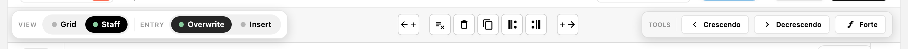

*Between the mode switches and the tools: insert, clear, delete, duplicate, and the two repeat barlines, all for the selected bar.*

## Track Actions

The action button on a track row opens the track menu, titled with the instrument's name:

- Add a new track. Its position in the arrangement depends on the instrument you choose; the `Add Tracks` dialog takes
  one or more instruments.
- Duplicate this track, including all notes and settings.
- Clear all notes and settings from the track.
- Delete this track and all notes in it.

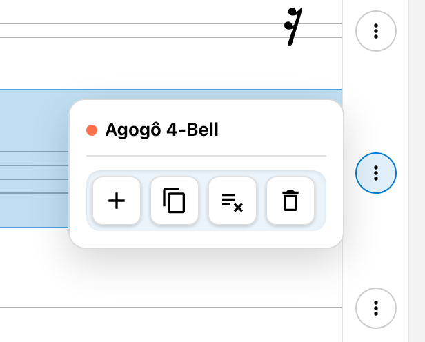

*The action button of a track row opens add, duplicate, clear, and delete for that track.*

## One-Bar Repeat

The track piece toolbar carries a one-bar repeat (simile) and a clear action:

- The simile mark stands for the previous bar of the same track. It is not available in the first bar, and the tooltip
  says so.
- Playback plays the bar the mark stands for.
- `Clear track piece` empties the covered bars of that track.

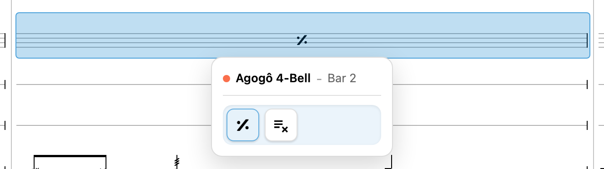

*The second bar of a track: the simile sign stands for bar 1, and the toolbar offers the repeat and the clear action.*

## Bar Widths

The closing barline of a bar can be dragged to make that bar narrower or wider, which helps to give a busy bar more room or to fit more bars on a screen. Double-clicking the handle restores the automatic width. The print preview offers the same adjustment.

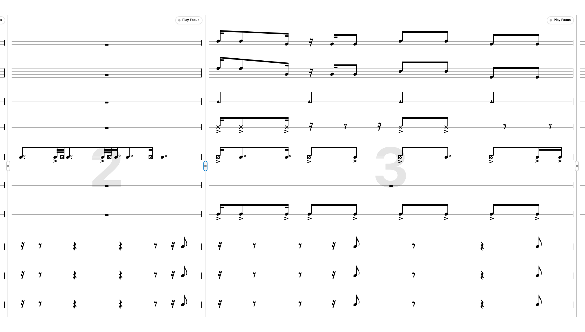

*Bars 2 and 3 with different widths; the grip on the right barline is the resize handle.*

## Dynamics

The `Tools` bar places volume marks: `Crescendo`, `Decrescendo`, and `Forte`. A tool stays active for placing and can be cancelled with `Cancel` or `Escape`. Placed marks can be dragged to another position and resized at their handles.

Dynamics affect the playback volume over the span they cover; the notes themselves are not changed.

## Clipboard

`Ctrl`/`Cmd`+`C`, `X`, and `V` copy, cut, and paste score content:

- Copying works in every mode. Cut and paste need edit mode.
- Pasting into another track can create a track when the source does not exist there yet.
- Content that does not fit the target is refused with a message instead of being pasted wrongly: `Cannot paste: at
  least one instrument does not match.`, `Cannot paste: the meter does not match.`, `Cannot paste: the track count does
  not match.`, and a warning about mixing subdivided and plain selections.

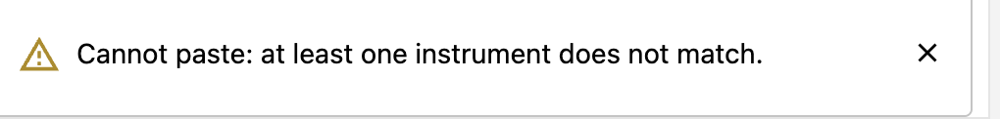

*The grid view reports a refused paste; the toast disappears, the message stays in the notification center.*

## Undo and Redo

The header's undo and redo buttons use the same history as the keyboard:

| Shortcut                 | Effect          |
| ------------------------ | --------------- |
| `Ctrl`/`Cmd`+`Z`         | Undo            |
| `Ctrl`/`Cmd`+`Shift`+`Z` | Redo            |
| `Ctrl`+`Y`               | Redo on Windows |

One edit is one undo step. Dragging a bar width or a dynamic is recorded once, when the gesture ends, not once per pixel. Reloading the application ends the history.

## Auto-Extend

With `Add a bar when notes run past the last one` enabled — the default — entering notes beyond the last bar appends a bar instead of dropping the note. Turning the setting off keeps the score's length fixed.

## Related Chapters

- [Instrument and Notation Reference](../instruments.md) explains the note styles and marks per instrument.
- [Editing in the Grid View](grid-editing.md) covers the grid workflow and what only the staff view can do.
- [Keyboard Shortcuts](../reference/keyboard-shortcuts.md) lists every key in one table.
- [Playback and Practice](playback.md) explains how repeats, simile, and dynamics are heard.
