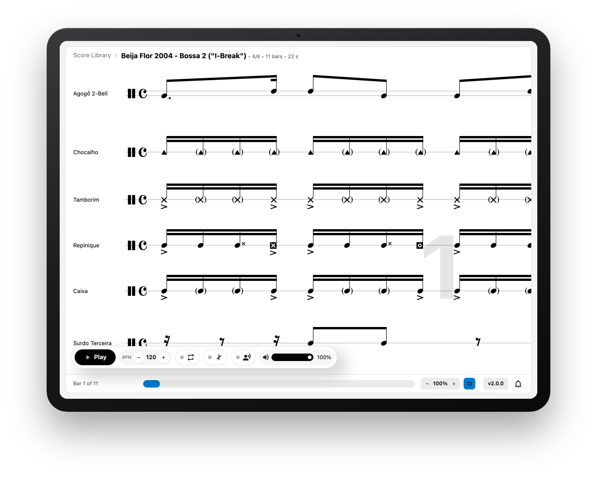
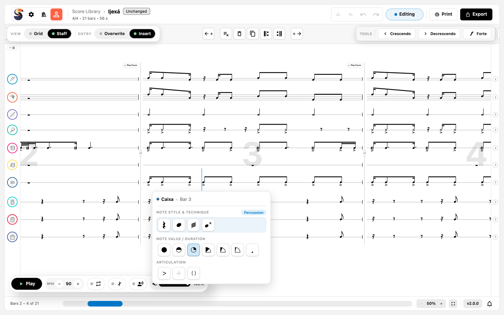

[](https://github.com/mike-lischke/animada-score-book/actions/workflows/nodejs.yml) [](./License.txt)

<p align="center">
<br/>
</p>

<hr />

# Animada Score Book

Animada Score Book keeps a Samba group's repertoire in one place and makes it playable. It is a browser application with a small backend: the backend stores scores, users, and permissions in a database, and the browser renders, plays, and edits them. One administrator installs the backend; everyone else needs only a browser and the address of that installation.

A score is written for a bateria. Eleven instrument types, from Agogô 2-Bell to the three surdos, each bring their own note styles, symbols, and samples, and the same score appears both as a note grid and as percussion notation.



*A score in Zen mode on a tablet: header and mode bar are gone, the title strip, the instrument names and the notation fill the screen, and the transport stays within reach.*

## Features

| Area           | What you get                                                                                                                                                                                                        |
| -------------- | ------------------------------------------------------------------------------------------------------------------------------------------------------------------------------------------------------------------- |
| Score library  | A folder tree of every score you can reach, with permission indicators for own, group-shared, and `World` entries, share links, and score locks that keep two people from editing the same score at once.           |
| Two views      | A grid view with one symbol per step, for learning and scanning, and a staff view with percussion notation, for playing; switch with `G` and `S`, also during playback.                                             |
| Notation       | Percussion clef, instrument-specific noteheads, accents, ghost and damped notes, crescendo and decrescendo hairpins with `f` markings, tuplets and nested tuplets, repeats, one-bar repeats, and bars of any width. |
| Editing        | Note entry with a note-length toolbar, dotted values, rests, overwrite and insert, note styles, articulations, clipboard, undo and redo, and automatic bar extension; both views edit the same score.               |
| Playback       | Transport, tempo, master volume, a per-track mixer with mute and focus, metronome, count-in, looping, `Play Focus` on a bar range, a scrolling playhead, and single-note preview.                                   |
| Presentation   | Seven SMuFL music fonts, thirteen color themes plus `Auto`, zoom from 50 % to 150 %, Zen mode, the score navigator, the notification center, and layouts for phones and tablets.                                    |
| Export         | A print preview with page setup for the browser's PDF output, and an MP3 export of the playback, including tempo, volume, and count-in.                                                                             |
| Administration | Users, groups, group login, fine-grained read and write access, brute-force limiting on logins, schema migrations, and documented backup, restore, and upgrade paths.                                               |

### Editing

Editing is part of the application, not a preview: notes are entered, given a note style and articulations, copied, pasted, subdivided, resized, and removed in both views, and the staff view adds a note-length toolbar. What arrived with each version is listed in the [release notes](release-notes.md).



*The staff view in edit mode: a selected note, the note style popup of the active track, and the toolbars around the score.*

[Editing in the Staff View](docs/en/using/staff-editing.md) and [Editing in the Grid View](docs/en/using/grid-editing.md) describe every control, and the [Instrument and Notation Reference](docs/en/instruments.md) explains what each symbol means.

## Start Here

| I want to …               | Start here                                                                                                        |
| ------------------------- | ----------------------------------------------------------------------------------------------------------------- |
| Use the application       | [Your First Session](docs/en/getting-started/first-steps.md) — signing in, opening a score, playing it, saving it |
| Install it on a server    | [Installing Animada Score Book](docs/en/administration/installation.md)                                           |
| Run it from the source    | [Development Setup](docs/en/development/setup.md)                                                                 |
| Look up a notation symbol | [Instrument and Notation Reference](docs/en/instruments.md)                                                       |
| Fix a problem             | [Troubleshooting and Known Limitations](docs/en/troubleshooting.md)                                               |

## Handbook

The English handbook in [`docs/en/`](docs/en/index.md) is the reference for everything the application does. A published HTML edition is planned in a separate website project; until then, these Markdown pages are the edition.

- **Getting Started** — [What Animada Score Book Is](docs/en/getting-started/overview.md) · [Your First Session](docs/en/getting-started/first-steps.md)
- **Using the Application** — [The Score Library](docs/en/using/score-library.md) · [Reading a Score](docs/en/using/presentation.md) · [Editing in the Staff View](docs/en/using/staff-editing.md) · [Editing in the Grid View](docs/en/using/grid-editing.md) · [Playback and Practice](docs/en/using/playback.md) · [Printing, PDF and MP3 Export](docs/en/using/printing-and-export.md)
- **Instruments and Notation** — [Instrument and Notation Reference](docs/en/instruments.md) for the eleven instrument types, their note styles, staff positions, and articulations
- **Administration** — [Installation](docs/en/administration/installation.md) · [Configuring the Backend](docs/en/administration/configuration.md) · [Users, Groups and Permissions](docs/en/administration/users-groups-permissions.md) · [Security Notes](docs/en/administration/security.md) · [Backup, Restore and Upgrades](docs/en/administration/backup-restore-upgrades.md)
- **Reference** — [Keyboard Shortcuts](docs/en/reference/keyboard-shortcuts.md) · [Glossary](docs/en/reference/glossary.md) · [Troubleshooting and Known Limitations](docs/en/troubleshooting.md)
- **Development** — [Development Setup](docs/en/development/setup.md) · [Architecture and Decisions](docs/en/development/architecture.md) · [Maintaining This Documentation](docs/en/development/documentation.md)

## Installation

Animada Score Book runs on one server. The backend serves the browser application and talks to MySQL, MariaDB, or PostgreSQL; it needs Node.js 24.15 or 26, a database account that may create tables, indexes, and foreign keys, and HTTPS in front of it, because the session cookie is `Secure`.

Build the deployment package with `npm run package`, unpack it on the server with `tar -xzf animada-score-book-<version>.tar.gz`, `cd` into the resulting directory, copy `backend-config.example.json` to `backend-config.json` and fill in the database block, then start it with `JWT_SECRET="<long random value>" node server.js`. A successful start logs `Backend server listening on http://127.0.0.1:3100 (bound to 0.0.0.0:3100)`, and the browser wizard afterwards creates the schema and the first administrator account.

The backend serves the interface itself, so a deployment needs two things: `node server.js` started **with the unpacked package as the working directory**, and the domain pointed at that process as a reverse proxy. The package carries no `index.html` in its root and `dist/` is not a document root; a statically served folder cannot answer `/api`, `/soundLib/`, or `/public/uploads/`.

[Installing Animada Score Book](docs/en/administration/installation.md) covers the package contents, database preparation, the first start, HTTPS, and upgrades; [Configuring the Backend](docs/en/administration/configuration.md) documents every key and environment variable.

## Development

The development environment needs the same Node.js and database, plus the local TLS certificates that the HTTPS dev server reads from `~/.ssh/localhost-key.pem` and `~/.ssh/localhost-cert.pem`.

```bash
npm install
cp backend-config.example.json backend-config.json   # then fill in the database block
npm run start-debug                                  # backend on port 3100, JWT_SECRET="for-debugging"
npm run dev                                          # frontend on https://localhost:5173
```

The dev server terminates TLS itself and proxies `/api` and `/soundLib` to the backend, so the browser only ever talks HTTPS; the self-signed certificate warns once.

| Command            | What it does                                                              |
| ------------------ | ------------------------------------------------------------------------- |
| `npm run check`    | Type-checks all TypeScript source and test files                          |
| `npm run lint`     | Runs ESLint across the codebase                                           |
| `npm run test`     | Runs the Vitest unit and integration tests                                |
| `npm run test:e2e` | Runs the Playwright end-to-end tests against a production build           |
| `npm run build`    | Builds fonts and themes, bundles the client, and checks the bundle budget |
| `npm run package`  | Writes `dist-package/animada-score-book-<version>.tar.gz`                 |

The project is written in TypeScript with Preact for the UI, SCSS and Tailwind for styling, and DaisyUI for components; the backend is a plain Node.js HTTP server with MySQL, MariaDB, and PostgreSQL adapters. [Development Setup](docs/en/development/setup.md) covers the toolchain, the branch-specific databases, and debugging in VS Code, and [Architecture and Decisions](docs/en/development/architecture.md) maps the codebase.

## Support

Found a problem? [Open an issue](../../issues) and describe what you were doing, what you expected, and what happened instead; screenshots and the browser console help. [Troubleshooting and Known Limitations](docs/en/troubleshooting.md) covers the common cases first.

## Releases, License and Architecture

- [Releases](../../releases) — the deployment packages and source archives of every version.
- [Release notes](release-notes.md) — what changed in each released version, newest first.
- [License](License.txt) — MIT.
- [Architecture decision records](docs/adr/readme.md) — the durable decisions behind the implementation; they stay in the repository and are not part of the deployment package.
